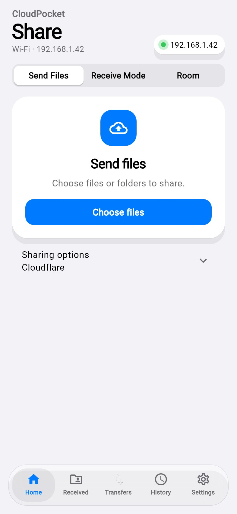
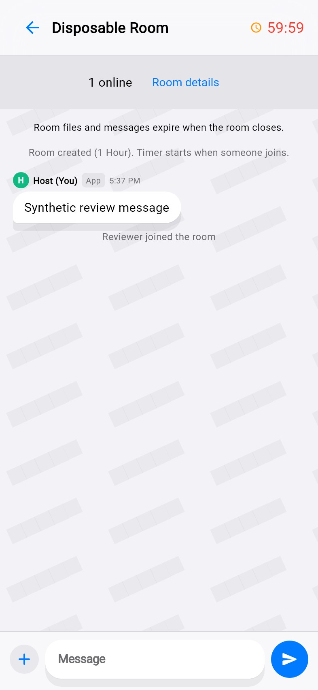
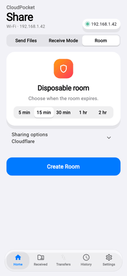
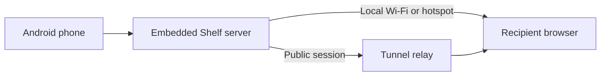

# CloudPocket

Share files directly from your Android phone over Wi-Fi, a hotspot, or an optional public tunnel. Recipients open a link in their browser; temporary rooms add chat and media sharing.

[](https://github.com/madebyarjun/CloudPocket/releases/latest)
[](https://github.com/madebyarjun/CloudPocket/actions/workflows/checks.yml)

  

## Features

- **Send files:** Share selected files and folders through the embedded web portal, with byte-range downloads and streaming ZIP archives.
- **Receive files:** Let browser users upload files to your phone through a dedicated drop zone with streaming uploads.
- **Local or internet sharing:** Use Wi-Fi/hotspot locally, or enable Cloudflare, LocalTunnel, Bore, or a custom Bore relay. Auto mode probes available providers and supports failover.
- **Disposable rooms:** Host temporary chat rooms with PIN protection, invite links, QR codes, NFC tap-to-join on compatible phones, and in-app attachment viewing. Messages and participant state remain in RAM; media uses a temporary app-cache sandbox.
- **Transfer controls:** Track uploads and downloads, view session history, and configure download limits with Vault mode.
- **Android integration:** Background foreground service, network interface selection, camera QR scanning, and guarded room media viewing.

## Install and start sharing

1. Open **Download latest APK** above and expand **Assets**. Choose **arm64-v8a** for most phones or **armeabi-v7a** for older phones running 32-bit Android. Both require Android 8.0 or later.
2. Open the APK and tap **Install**. If prompted, allow your browser or file manager to install unknown apps. You can revoke that permission afterward.
3. Open CloudPocket and choose **Send**, **Receive**, or **Room**. For local sharing, connect both devices to the same Wi-Fi or hotspot. For remote access, select a tunnel provider.
4. Start the session and share its link or QR code. Recipients can join in a browser. Stop sharing or close the room when finished.

Upgrading from the v1.0.0 test APK may require a fresh install because the signing key changed. Uninstalling can erase local app data. [Release verification](docs/RELEASE.md) · [Changelog](CHANGELOG.md)

## Development setup

This branch uses:

| Requirement | Version / notes |
| --- | --- |
| Flutter | 3.13.9 stable |
| Dart | 3.1.5; package constraint `>=3.1.5 <4.0.0` |
| Android SDK | Compile/target 34; minimum 26 |
| Java | 17 for Android tooling |
| Node.js | 18+ for browser unit tests |
| Android release architecture | ARM64 (`arm64-v8a`) and ARMv7 (`armeabi-v7a`) |

Install Git LFS and run `git lfs pull` after cloning to fetch both ARM tunnel executables. From the project root:

```powershell
flutter pub get
flutter run
```

Build the signed APKs with your release keystore in `android/key.properties`:

```powershell
flutter build apk --release --split-per-abi --target-platform android-arm,android-arm64
```

Use a physical device of each architecture to exercise its bundled Cloudflare executable. An x86_64 debug emulator can exercise local sharing but cannot run that ARM64 binary; use LocalTunnel or Bore when testing other tunnel paths.

Platform scaffold directories are included for other Flutter targets; their presence does not establish feature parity or release support.

## Verification

```powershell
flutter analyze
flutter test
node --test test/web/client.test.cjs
```

On Windows, the combined check script also validates JavaScript syntax:

```powershell
./tool/check.ps1 -FlutterRoot <path-to-Flutter-3.13.9>
```

Production signing requires private configuration in `android/key.properties`; never commit signing keys or credentials. See [testing](docs/TESTING.md) and [release gates](docs/RELEASE.md) for device checks and publishing requirements.

## Known limitations and privacy

- Cloudflare Quick Tunnel can fail during DNS lookup. Enabling the hotspot worked on one tested phone. Two-phone NFC and locked-screen transfer checks remain open.
- Local file sharing uses HTTP. Network observers may see files and credentials. Local browser chat may fall back to plaintext when encryption is unavailable, with a visible warning; public HTTP chat without encryption is blocked.
- Cloudflare and LocalTunnel terminate HTTPS at their relays. AES-256-GCM protects encrypted chat payloads, but the current credential exchange does not establish secrecy from relay operators. Bore uses unencrypted HTTP.
- Room messages and participant state stay in memory. Temporary media is stored in an app-cache sandbox and removed during cleanup. Deletion unlinks files; it does not securely erase flash storage.
- Android uses `FLAG_SECURE` for protected room views where supported. Browser controls and watermarks cannot prevent screenshots or copying by recipients.
- Public Chat ID discovery uses `ntfy.sh`, requires a PIN, and does not publish the invite token. Discovery topics are public and do not authenticate room ownership.

Read the [security model](docs/SECURITY.md) and [privacy disclosure](docs/PRIVACY.md) before sharing sensitive content.

## Architecture



## Project structure

```text
lib/models/       Session, room, message, and transfer models
lib/providers/    Riverpod application state
lib/server/       Embedded Shelf server, streaming I/O, and chat hub
lib/services/     Encryption, networking, permissions, and Android services
lib/tunnel/       Tunnel clients, provider selection, and health monitoring
lib/ui/           Flutter screens and widgets
assets/web/       Browser file-sharing and chat clients
test/             Flutter and browser unit tests
tool/             Verification and preview utilities
docs/             Architecture, security, testing, and release guidance
```

## Documentation and contributing

- [Contributing](CONTRIBUTING.md)
- [Architecture](docs/ARCHITECTURE.md)
- [Testing guide](docs/TESTING.md)
- [Release readiness](docs/RELEASE.md)
- [App screen gallery](UI/README.md)
- [UI and functionality guide](docs/UI_UX_AND_FUNCTIONALITY_GUIDE.md)
- [UI review](docs/ui-review/REPORT.md)

Keep contributions limited to the requested feature or fix, preserve streaming file I/O, and keep chat state ephemeral. Run the relevant checks and report device-dependent behavior as unverified until tested.

## License

[MIT](LICENSE) - Copyright (c) 2026 madebyarjun. Third-party dependencies and bundled binaries retain their respective licenses.
