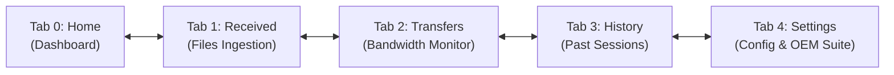

# CloudPocket UI/UX Design System Specification

## 1. Design Philosophy
CloudPocket blends the frictionless peer-to-peer immediacy of Apple AirDrop with the high-assurance security posture of Signal and Tor. 

The visual design language is anchored in three core principles:
1. **Frictionless Zero-Install Access**: Receivers never need to install software, create accounts, or configure routers. The UI on both the native Android host and client web browsers must feel immediate, responsive, and intuitive.
2. **Deterministic Security State**: Security boundaries (such as Local-Only mode, PIN protection, RAM-only ephemeral chat, and hardware screenshot guards) are communicated through unmistakable visual status indicators, glowing badges, and real-time state machines.
3. **High-Performance Dark Aesthetic**: Engineered specifically for AMOLED and OLED mobile displays. Deep slate/black backgrounds minimize battery drain during intensive multi-gigabyte transfers while neon cyan (`#00B0FF`) and emerald green (`#00E676`) accents provide high-contrast legibility.

---

## 2. Color Palette & Semantic Tokens

CloudPocket utilizes Material Design 3 dynamic tokens extended with semantic status colors via [`CloudPocketColors`](../lib/ui/theme.dart):

```
+-------------------------------------------------------------------------+
|                              BASE PALETTE                               |
+-------------------+-------------------+---------------------------------+
| Token             | Hex Value         | Semantic Usage                  |
+-------------------+-------------------+---------------------------------+
| Background        | #0D1117           | Main scaffold canvas            |
| Surface Variant   | #161B22           | Cards, sheets, dialog containers|
| Surface Tint      | #21262D           | Interactive item hovers & chips |
| Primary Accent    | #00B0FF           | Primary actions, links, sliders |
| Secondary Accent  | #00E676           | Success states, active transfers|
| Warning Accent    | #FBBF24           | Battery limit prompts, low space|
| Danger Accent     | #F87171 / #DC2626 | Stop server, purge room, abort  |
| Outline Variant   | #30363D           | Thin card borders & dividers    |
+-------------------+-------------------+---------------------------------+
```

### Semantic Status Tokens
- **Online / Running (`success`)**: `#4ADE80` (Dark) / `#16A34A` (Light). Used for the server pulsing dot, active Wi-Fi chips, completed transfers, and verified encryption shields.
- **Warning (`warning`)**: `#FBBF24` (Dark) / `#D97706` (Light). Used for battery optimization alerts and storage warnings.
- **Danger (`danger`)**: `#F87171` (Dark) / `#DC2626` (Light). Used for self-destruct timers, stop server triggers, and delete actions.
- **Info (`info`)**: `#22D3EE` (Dark) / `#0891B2` (Light). Used for discovery codes, room tokens, and telemetry speeds.

---

## 3. Typography Hierarchy
CloudPocket enforces clean, geometric typography with generous line-heights and high contrast against dark surfaces:

- **Display Header (22sp, SemiBold, -0.4 letter spacing)**: Screen titles, brand headers.
- **Card Title (16sp, Medium)**: Mode names, file names, dialog headings.
- **Body Regular (14sp, Regular, 1.4 line-height)**: Explanatory notes, instructions, settings descriptions.
- **Monospaced Data (13sp, Monospace)**: IP addresses, listening ports, room discovery codes (`NX-7204`), encryption tags.
- **Telemetry Micro-Labels (11sp, Bold, Uppercase)**: Transfer speedometers, client counters, countdown timers.

---

## 4. Navigation Architecture & Curved Nav Bar Physics

CloudPocket uses a custom animated curved bottom navigation bar ([`SmoothCurvedNavBar`](../lib/ui/widgets/smooth_curved_nav_bar.dart) and [`AppShell`](../lib/ui/app_shell.dart)):



### Motion & Physics
1. **Curved Bezier Notch**: As the user switches tabs, a smooth cubic Bezier notch travels horizontally along the navigation bar, seamlessly nestling under the active tab icon.
2. **Elevated Floating Active Button**: The selected tab icon rises slightly into an elevated circular bubble glowing with the primary accent color (`#00B0FF`).
3. **Continuous Drag / Swipe Switching**: In addition to tapping tab icons, users can drag their finger horizontally across the bottom bar ([`_onBarDrag`](../lib/ui/app_shell.dart)) to scrub smoothly between tabs, with selection haptic clicks firing at each tab boundary.
4. **Smooth Page Crossfade**: Tab transitions employ a coordinated dual-curve crossfade: the leaving tab fades out along `Interval(0.0, 0.45, Curves.easeIn)` while the entering tab fades in along `Interval(0.4, 1.0, Curves.easeOut)`.

---

## 5. Security & State Isolation UX Patterns

### 5.1 Send Mode vs. Receive Mode Blast-Radius Isolation
Switching between sharing modes triggers a strict state purge:
- Tapping **Receive Mode** instantly calls `session.items.clear()`.
- Staged outgoing files are purged from memory, ensuring a user never accidentally distributes private files while attempting to receive files from others.

### 5.2 Ephemeral Lifecycle & Zero-Disk Persist Guarantee
When hosting Disposable Rooms:
- Messages exist exclusively in RAM within `ChatHub`.
- The UI maintains an active self-destruct countdown timer that visually pulses in red when under 5 minutes.
- Tapping **"Terminate & Shred Room Now"** invokes `DisposableRoom.dispose()`, wiping the in-memory chat list and deleting temporary decrypt caches immediately.

### 5.3 Hardware `FLAG_SECURE` Countermeasure
When opening confidential media in [`RoomMediaViewerScreen`](../lib/ui/widgets/room_media_viewer.dart):
- `window.setFlags(FLAG_SECURE, FLAG_SECURE)` hardware-locks the Android display pipeline.
- Screenshot captures and screen recording apps capture only black screens.
- Recents app-switcher cards are replaced with privacy blanks.
- A dynamic semi-transparent watermark overlays the user's IP and timestamp across the image.

---

## 6. Haptic Feedback & Micro-Interactions

| User Action | Haptic Pattern | Sensory Feedback |
| :--- | :--- | :--- |
| **Tab Change / Bar Drag** | `HapticFeedback.selectionClick()` | Light, crisp tactile tick |
| **File Staged / Checkbox Pick** | `HapticFeedback.lightImpact()` | Soft acknowledgment bump |
| **Start Server / Room Launch** | `HapticFeedback.mediumImpact()` | Solid confirmation surge |
| **Secret 6-Tap Diagnostics** | `HapticFeedback.heavyImpact()` | Deep haptic pulse upon unlock |
| **Stop Server / Abort Transfer**| `HapticFeedback.mediumImpact()` | Distinct teardown tactile pulse |
