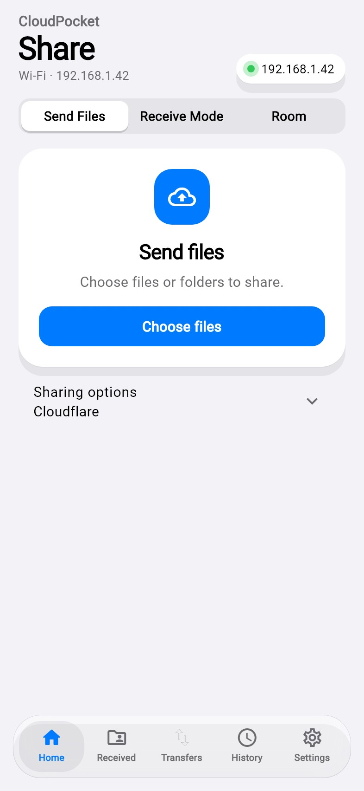
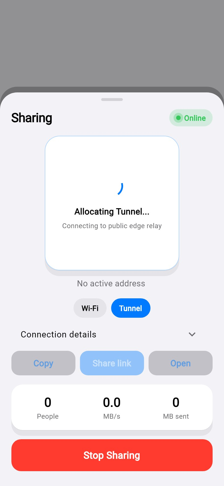
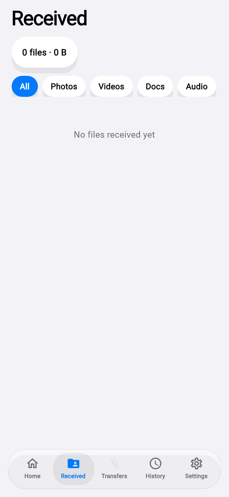
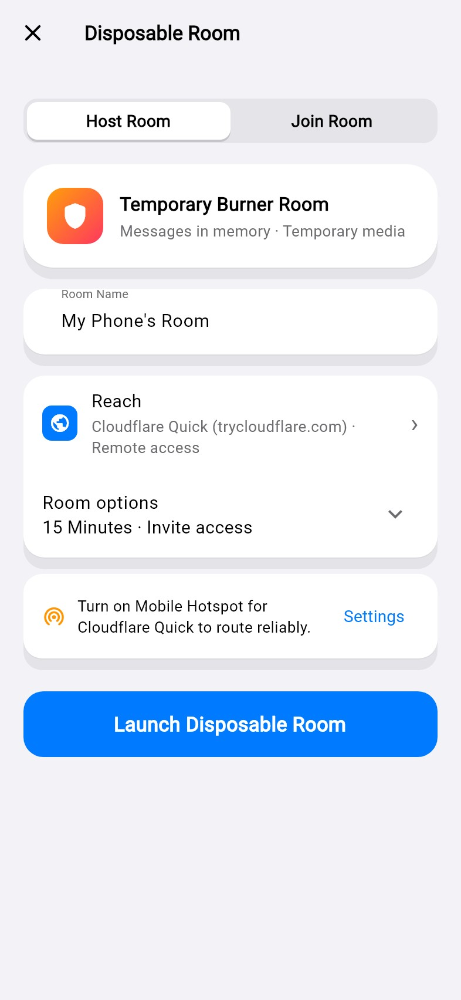
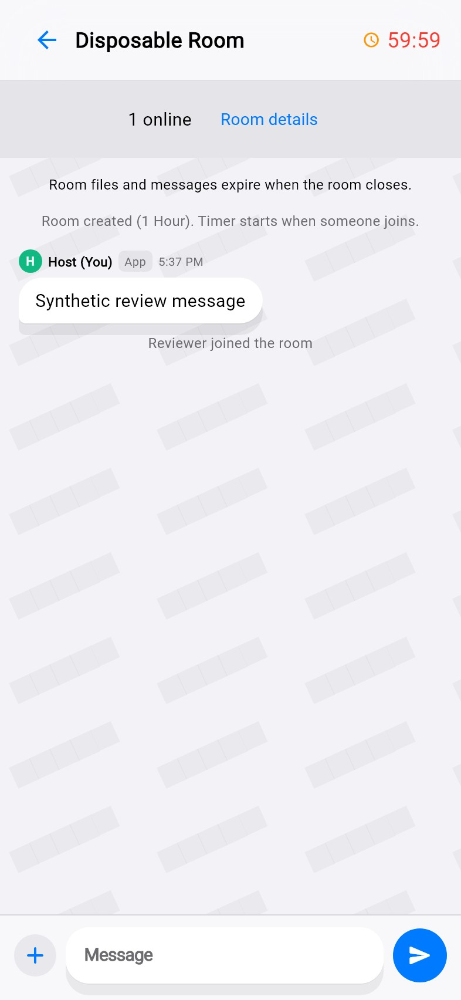
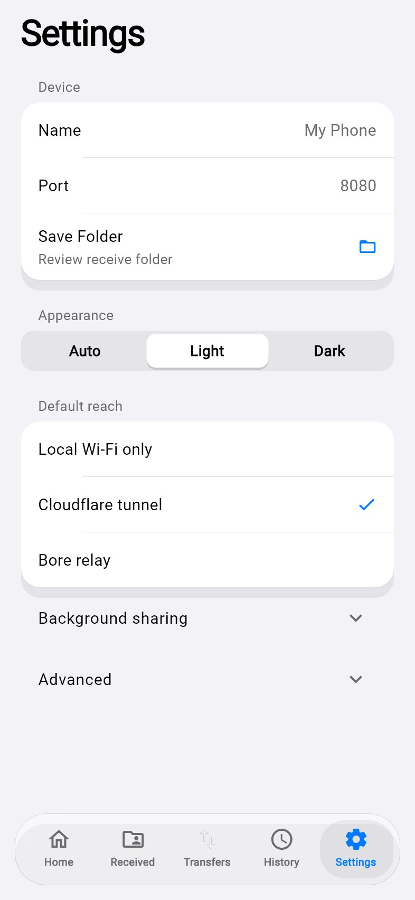
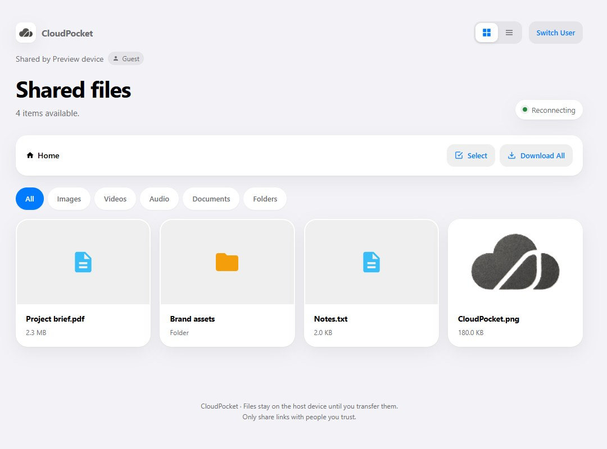

# CloudPocket screens

Android screens rendered from the v1.0.2 Flutter widgets with sample session data. Browser screens use the local preview fixture.

## Sharing

| Home | Sharing session | Receive mode |
| --- | --- | --- |
|  |  |  |

## Transfers and rooms

| Active transfer | Received files | Room setup |
| --- | --- | --- |
|  |  |  |

## Chat and settings

| Room chat | Text attachment | Settings |
| --- | --- | --- |
|  |  |  |

## Browser client

| Browser file sharing | Browser room entry |
| --- | --- |
|  |  |

[Design system](DESIGN_SYSTEM.md)
