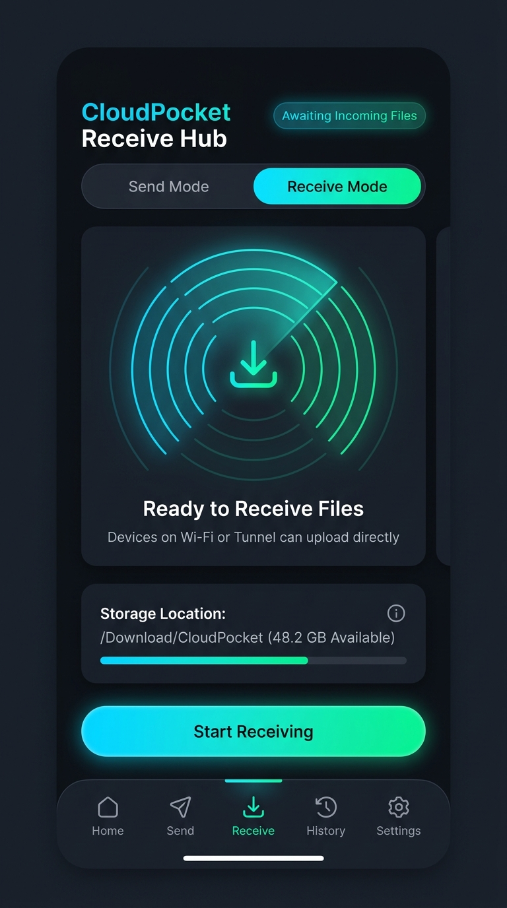
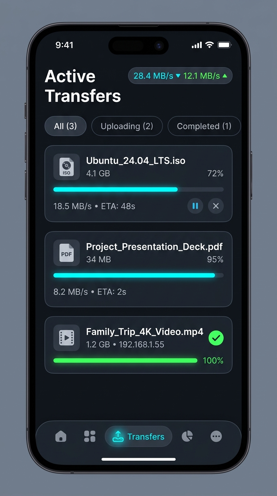
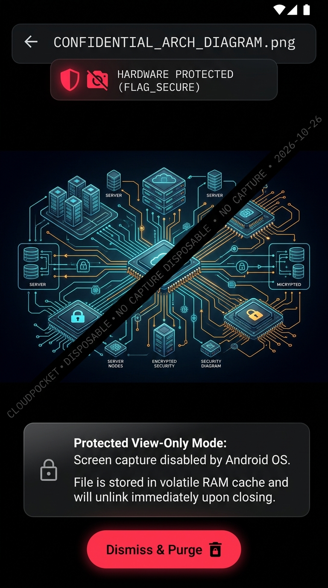
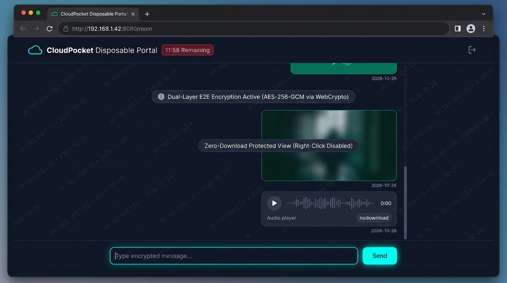

# CloudPocket UI/UX Complete Architecture & Screen Reference Manual

Welcome to the **CloudPocket UI/UX Master Reference Manual**. This folder documents every screen, user journey, interaction model, state transition, visual token, and security guarantee across the CloudPocket mobile application and its responsive browser client suite.

---

## 1. Visual Gallery of App Screens

| 01. Home Dashboard | 02. Sharing Live View | 03. Dedicated Receive Mode |
| :---: | :---: | :---: |
| [](screens/01_HOME_DASHBOARD.md) | [](screens/02_SHARING_LIVE_VIEW.md) | [](screens/03_RECEIVE_MODE.md) |
| [Deep Dive Guide](screens/01_HOME_DASHBOARD.md) | [Deep Dive Guide](screens/02_SHARING_LIVE_VIEW.md) | [Deep Dive Guide](screens/03_RECEIVE_MODE.md) |

| 04. Transfers Dashboard | 05. Received Files Manager | 06. Disposable Room Setup |
| :---: | :---: | :---: |
| [](screens/04_TRANSFERS_DASHBOARD.md) | [](screens/05_RECEIVED_FILES_MANAGER.md) | [](screens/06_DISPOSABLE_ROOM_SETUP.md) |
| [Deep Dive Guide](screens/04_TRANSFERS_DASHBOARD.md) | [Deep Dive Guide](screens/05_RECEIVED_FILES_MANAGER.md) | [Deep Dive Guide](screens/06_DISPOSABLE_ROOM_SETUP.md) |

| 07. Ephemeral Room Chat | 08. Hardware-Secured Viewer | 09. Settings & OEM Suite |
| :---: | :---: | :---: |
| [](screens/07_EPHEMERAL_CHAT_AND_MEDIA.md) | [](screens/08_HARDWARE_SECURED_VIEWER.md) | [](screens/09_SETTINGS_AND_OEM_BATTERY.md) |
| [Deep Dive Guide](screens/07_EPHEMERAL_CHAT_AND_MEDIA.md) | [Deep Dive Guide](screens/08_HARDWARE_SECURED_VIEWER.md) | [Deep Dive Guide](screens/09_SETTINGS_AND_OEM_BATTERY.md) |

| 10. Web Client File Sharing | 11. Web Disposable Portal |
| :---: | :---: |
| [](screens/10_WEB_CLIENT_PORTALS.md) | [](screens/10_WEB_CLIENT_PORTALS.md) |
| [Deep Dive Guide](screens/10_WEB_CLIENT_PORTALS.md) | [Deep Dive Guide](screens/10_WEB_CLIENT_PORTALS.md) |

---

## 2. Directory Structure & Document Index

```
UI/
├── README.md                           # Master UI/UX index & architectural manual
├── DESIGN_SYSTEM.md                    # Themes, color tokens, typography & haptics
├── screenshots/                        # High-resolution UI screenshots for every screen
│   ├── 01_home_dashboard.jpg           # Home Screen in Send Mode
│   ├── 02_sharing_live_view.jpg        # Active server session & QR code view
│   ├── 03_receive_mode.jpg             # Dedicated incoming file drop-zone
│   ├── 04_transfers_tab.jpg            # Real-time transfers & bandwidth speedometer
│   ├── 05_received_files_tab.jpg       # File repository & category manager
│   ├── 06_disposable_room_setup.jpg    # Disposable room countdown & discovery setup
│   ├── 07_disposable_room_chat.jpg     # Ephemeral chat timeline & E2E shield
│   ├── 08_secured_media_viewer.jpg     # FLAG_SECURE protected media viewer
│   ├── 09_settings_and_oem.jpg         # Settings tab & OEM battery suite
│   ├── 10_web_portal_file_sharing.jpg  # Browser client file portal (Desktop/Mobile)
│   └── 11_web_disposable_room.jpg      # Browser client disposable chat portal
└── screens/                            # Comprehensive screen-by-screen deep dive guides
    ├── 01_HOME_DASHBOARD.md            # Home dashboard, staging, and tunnel choices
    ├── 02_SHARING_LIVE_VIEW.md         # QR code generation, multi-IP switcher & stats
    ├── 03_RECEIVE_MODE.md              # Zero-buffer streaming & state isolation
    ├── 04_TRANSFERS_DASHBOARD.md       # Transfer cards, ETA algorithms, pause/resume
    ├── 05_RECEIVED_FILES_MANAGER.md    # Thumbnails, storage bar, categories & actions
    ├── 06_DISPOSABLE_ROOM_SETUP.md     # Timers, PIN hashing, discovery codes & QR join
    ├── 07_EPHEMERAL_CHAT_AND_MEDIA.md  # RAM-only WebSocket timeline & AES-256-GCM
    ├── 08_HARDWARE_SECURED_VIEWER.md   # FLAG_SECURE window lock & dynamic watermark
    ├── 09_SETTINGS_AND_OEM_BATTERY.md  # MIUI, Samsung, ColorOS battery bypass cards
    └── 10_WEB_CLIENT_PORTALS.md        # Responsive HTML5/WebCrypto browser client suite
```

---

## 3. Core UI/UX Subsystems & Architecture

```mermaid
graph TD
    AppShell["AppShell Scaffold<br/>(SmoothCurvedNavBar)"] --> Tab0["Tab 0: HomeScreen<br/>(Idle / Config)"]
    AppShell --> Tab1["Tab 1: ReceivedFilesTab<br/>(/Download/CloudPocket)"]
    AppShell --> Tab2["Tab 2: TransfersTab<br/>(Bandwidth & ETAs)"]
    AppShell --> Tab3["Tab 3: HistoryTab<br/>(Past Share Sessions)"]
    AppShell --> Tab4["Tab 4: SettingsTab<br/>(OEM Battery & Logs)"]

    Tab0 -->|Start Server (Send / Receive)| SharingLive["SharingLiveView<br/>(QR Code, Multi-IP, Stats)"]
    Tab0 -->|Start Server (Disposable Room)| RoomLive["DisposableRoomLiveView<br/>(Countdown & Room Hub)"]
    RoomLive --> RoomChat["RoomChatScreen<br/>(RAM-Only E2E Chat)"]
    RoomChat --> SecuredViewer["RoomMediaViewerScreen<br/>(FLAG_SECURE Anti-Capture)"]

    SharingLive -.->|HTTP / WebSocket| WebPortal["Browser Client Portal<br/>(assets/web/)"]
```

### 3.1 Seamless Mode Switching & Zero-Leak Blast Radius
1. **Send Mode**: The user stages files from their device using the high-performance [`FileSelectorScreen`](file:///f:/Project/CloudPocket/lib/ui/screens/file_selector_screen.dart). Staged files are summarized in interactive cards. Web clients visiting the portal can download files individually or as a single on-the-fly streaming ZIP.
2. **Receive Mode**: Tapping Receive Mode automatically triggers `session.items.clear()`, completely flushing any staged private files from memory. The server endpoint changes into an upload ingest pipe, streaming incoming uploads directly into `/Download/CloudPocket/` without buffering in RAM.
3. **Disposable Room Mode**: Converts the server into a self-destructing, in-memory ephemeral chat room. No transcripts or decrypt keys are written to disk.

### 3.2 Public Internet & Local Network Perimeter
CloudPocket gives the user total transparency over where their data flows:
- **Local Wi-Fi Only**: Locks traffic to the internal LAN (`0.0.0.0:8080`), rendering the server unreachable from the public internet.
- **Auto Smart Tunnel**: Automatically probes multiple tunneling providers (Cloudflare Quick Tunnel, LocalTunnel, Bore) in parallel and selects the fastest, most reliable connection.
- **Multi-Interface IP Chip Switcher**: When a phone has Wi-Fi, Hotspot, and USB tethering active at once, the live view surfaces distinct chips for each IP so the user can share the exact route matching their receiver's network.

### 3.3 Hardware-Enforced Security UX
- **Android `FLAG_SECURE`**: When sensitive media is viewed in `RoomMediaViewerScreen`, native window manager flags block operating system screenshots, screen recorders, and app-switcher previews.
- **Dynamic Watermark Canvas**: The recipient's IP and current timestamp are subtly watermarked across the viewport to deter physical camera photography.
- **Immediate Memory Purge**: Upon closing the media viewer or terminating the disposable room, all decrypted byte arrays are wiped from RAM and temporary decrypt files are deleted from the disk cache.

---

## 4. Dialogs, Sheets & Micro-Experiences

In addition to the primary screens, CloudPocket includes specialized floating components:
1. **QR Scanner Sheet ([`QrScannerSheet`](file:///f:/Project/CloudPocket/lib/ui/widgets/qr_scanner_sheet.dart))**: A bottom sheet embedding `mobile_scanner` with an animated holographic reticle that decodes room links, tokens, and PINs in milliseconds.
2. **Clipboard Auto-Detector ([`RoomLinkDetector`](file:///f:/Project/CloudPocket/lib/services/room_link_detector.dart))**: Whenever the user opens CloudPocket with a room link copied to their system clipboard, a floating dark slate snackbar appears with an immediate **"JOIN ROOM"** action.
3. **Hotspot Prompt Dialog ([`HotspotPromptDialog`](file:///f:/Project/CloudPocket/lib/ui/widgets/hotspot_prompt_dialog.dart))**: Detects if the device is disconnected from Wi-Fi and guides the user to launch their Wi-Fi hotspot with a single tap.
4. **Secret Log Terminal ([`LogViewerDialog`](file:///f:/Project/CloudPocket/lib/ui/widgets/log_viewer_dialog.dart))**: Unlocked by tapping the Settings tab icon 6 times. Displays an in-memory stream of Shelf server requests, DNS logs, and socket errors without logging sensitive passwords or room tokens.

---

For complete details on color tokens, typography scales, animation curves, and accessibility specifications, see [`DESIGN_SYSTEM.md`](DESIGN_SYSTEM.md).
