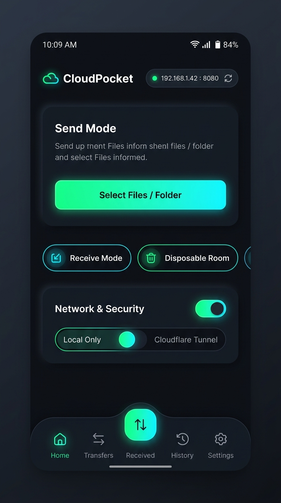
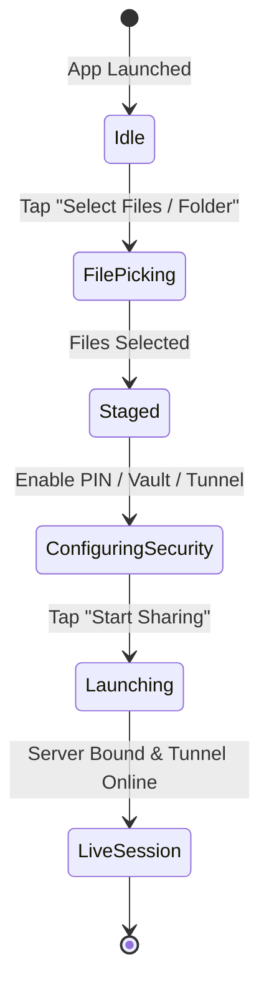

# Screen 01: Home Dashboard & Configuration Hub

## 1. Overview & Architectural Role
The **Home Dashboard** ([`HomeScreen`](file:///f:/Project/CloudPocket/lib/ui/screens/home_screen.dart#L25-L1009)) is the primary command center of CloudPocket. It orchestrates server configuration, file staging, security parameters, public internet tunneling, and network interface detection before a sharing session is launched.

When the embedded Shelf server is not actively serving requests, `HomeScreen` presents an intuitive setup canvas where users can toggle modes, select files, configure vault limits, and activate tunnels.

---

## 2. Visual Hierarchy & UI Breakdown

### 2.1 Top App Bar & Identity
- **Branding**: Displays the custom high-contrast CloudPocket icon along with the product name and current release version.
- **Network Interface Indicator**: A dynamic chip on the right side of the app bar displays the host's active primary IP address and listening port (e.g., `192.168.1.42:8080`).
  - Pulsing green dot: Connected to a valid Wi-Fi or Local Hotspot network.
  - Amber dot: Local loopback only (`127.0.0.1`), indicating no active Wi-Fi or cellular hotspot is detected.
- **Battery Optimization Banner**: If Android battery optimization is active (which risks the OS freezing background sockets when the screen is locked), a warning chip/banner prompts the user with one-tap exemption via [`PermissionService.requestIgnoreBatteryOptimization()`](file:///f:/Project/CloudPocket/lib/services/permission_service.dart).

### 2.2 Mode Switcher (Segmented Control)
Located directly beneath the app bar is a 3-way animated `SegmentedButton` or mode switcher:
1. **Send Files Mode** *(Default)*: Enables multi-category file selection for distribution to client browsers.
2. **Receive Mode**: Switches the dashboard into an incoming drop-zone hub, purges staged send files, and prepares the server to accept uploads directly into storage.
3. **Disposable Room**: Reconfigures the server into a self-destructing, RAM-only, end-to-end encrypted chat and media channel.

### 2.3 Staged Files Hero Card
- **Zero-File State**: Displays an illustrated cloud upload graphic with the prompt *"No files staged yet. Tap below to pick photos, videos, documents, or entire folders."*
- **Populated State**: A scrollable horizontal carousel displaying thumbnails, file type badges, names, and byte sizes. Includes a quick "Clear All" pill and individual removal buttons.
- **Primary CTA**: A glowing gradient button (`#00B0FF` to `#00E676`) reading **"Select Files / Folder"**, which opens the high-performance categorized file picker ([`FileSelectorScreen`](file:///f:/Project/CloudPocket/lib/ui/screens/file_selector_screen.dart)).

### 2.4 Security & Session Configuration Cards
- **PIN Protection Toggle**: Enables 4-to-6 digit numeric PIN authentication. When active, web visitors must enter the correct PIN before gaining access to file lists or endpoints.
- **Download Limits (Vault Mode)**: Enforces single-use or fixed download limits per file (HTTP 410 Gone when exhausted) using [`VaultTracker`](file:///f:/Project/CloudPocket/lib/server/vault_tracker.dart).
- **Public Tunnel Selector**:
  - `Local Only`: Restricts traffic strictly to the local Wi-Fi / Hotspot subnet (`0.0.0.0:8080`).
  - `Cloudflare Quick Tunnel`: Runs embedded `MicroDnsServer` and `libcloudflared.so` to provision a secure `https://*.trycloudflare.com` URL without port forwarding.
  - `LocalTunnel`: Pure Dart HTTP allocation over `loca.lt`.
  - `Bore (VPS)`: Lightweight TCP relay client connecting to `bore.pub` or a custom VPS.
  - `Smart Auto`: Parallel HTTP latency probing (<2s) that automatically picks the fastest tunnel provider.

### 2.5 Launch Bar & Action Trigger
- **Start Sharing Button**: A prominent, full-width rounded pill button anchored above the curved navigation bar. Tapping this triggers [`ServerProvider.startServer()`](file:///f:/Project/CloudPocket/lib/providers/server_provider.dart), transitions the state machine to `ServerRunning`, and seamlessly mounts [`SharingLiveView`](file:///f:/Project/CloudPocket/lib/ui/widgets/sharing_live_view.dart).

---

## 3. UX Behavior & State Transitions

### 3.1 Edge Case UX Handling
- **Clipboard Room Detection**: If a user copies a CloudPocket room link (e.g., `http://192.168.1.42:8080/room?token=...#key=...`) from WhatsApp, Telegram, or SMS, [`RoomLinkDetector`](file:///f:/Project/CloudPocket/lib/services/room_link_detector.dart) catches it upon resuming the app and presents a floating snackbar with a one-tap **"JOIN ROOM"** action.
- **No Wi-Fi / No Hotspot Prompt**: If neither Wi-Fi nor mobile hotspot is detected, tapping "Start Sharing" displays [`HotspotPromptDialog`](file:///f:/Project/CloudPocket/lib/ui/widgets/hotspot_prompt_dialog.dart), guiding the user to turn on their Portable Hotspot with a single tap.
- **Haptic Feedback**: Medium impact haptic feedback on file selection, selection click on segmented button switches, and success pattern on server launch.
