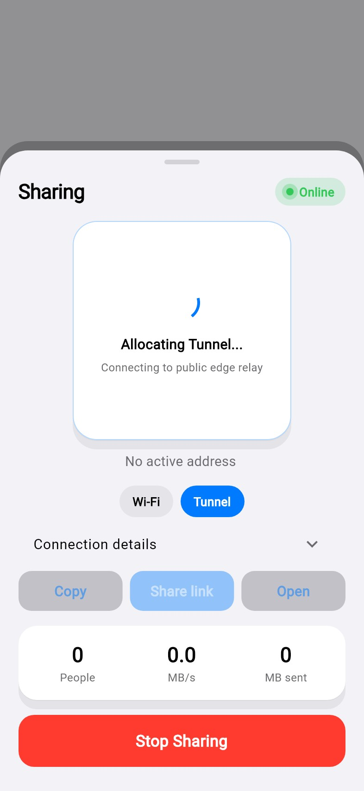
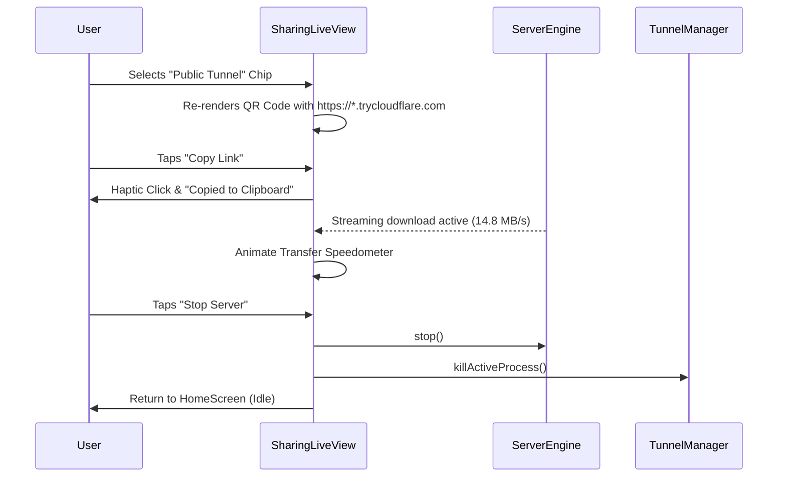

# Screen 02: Sharing Live View (Active Server Session)

## 1. Overview & Architectural Role
The **Sharing Live View** ([`SharingLiveView`](../../lib/ui/widgets/sharing_live_view.dart)) replaces the Home Dashboard the instant the local HTTP server starts. It acts as an active transmission console, giving the host user instant visual feedback on server status, connected client counts, active IP addresses, live transfer bandwidth, and seamless link distribution methods.

---

## 2. Visual Hierarchy & UI Breakdown

### 2.1 Live Status Bar
- **Pulsing Status Indicator**: A glowing emerald neon dot with radiating ripples indicating the embedded Shelf server is actively listening.
- **Session Duration Clock**: Real-time elapsed time counter (`HH:MM:SS`) tracking uptime.
- **Port Badge**: Clearly states the bound port (`:8080` by default).

### 2.2 High-Contrast Center QR Code Card
- **Styling**: Rendered using [`PrettyQr`](../../lib/ui/widgets/sharing_live_view.dart) with custom rounded blocks, high contrast foreground on a pure dark card, and a glowing cyan frame.
- **Dynamic Encoding**: Encodes the currently selected URL (Wi-Fi, Hotspot, or Public Cloudflare Tunnel). Scanning with any standard camera immediately navigates the receiver to the web portal.
- **Tap-to-Enlarge**: Tapping the QR code expands it into a fullscreen high-luminance modal for easy scanning across rooms or outdoor environments.

### 2.3 Multi-Interface IP Chip Switcher
Mobile devices often maintain multiple network interfaces simultaneously (e.g., connected to home Wi-Fi `192.168.1.42`, running a mobile hotspot on `192.168.43.1`, or tethering via Wi-Fi Direct on `192.168.49.1`).
- The UI provides horizontal interactive filter chips:
  - `[Wi-Fi: 192.168.1.42:8080]`
  - `[Hotspot: 192.168.43.1:8080]`
  - `[Public Tunnel: https://pocket-xyz.trycloudflare.com]`
- Selecting a chip instantly updates the displayed URL, re-renders the QR code with the new address, and syncs the clipboard copy target.

### 2.4 Quick Distribution Action Bar
- **Copy Link**: Copies the active sharing URL to the system clipboard and triggers a confirmation snackbar.
- **Share Intent**: Triggers the native Android system share-sheet (`share_plus`) to send the link via WhatsApp, Telegram, Gmail, SMS, or Nearby Share.
- **Open in Browser**: Launches the default web browser on the host device to preview what clients see.

### 2.5 Real-Time Telemetry & Performance Dashboard
Displays three live performance indicators powered by [`StatsProvider`](../../lib/providers/stats_provider.dart):
1. **Connected Clients**: Real-time counter of unique client IP addresses communicating with the server.
2. **Transfer Speedometer**: Live upload and download speeds updated at 1 Hz intervals (e.g., `14.8 MB/s ▲  1.2 MB/s ▼`).
3. **Total Data Transferred**: Cumulative session bandwidth counter (e.g., `420 MB transferred`).

### 2.6 Emergency & Graceful Termination
- **Stop Server Button**: A prominent dark crimson outlined/filled button at the base of the view. Tapping it initiates a graceful socket teardown, terminates active public tunnel processes (`libcloudflared.so` / `localtunnel`), saves the session summary to [`HistoryProvider`](../../lib/providers/history_provider.dart), and returns the UI to the Home Dashboard.

---

## 3. Interaction Flow & Life-Cycle

