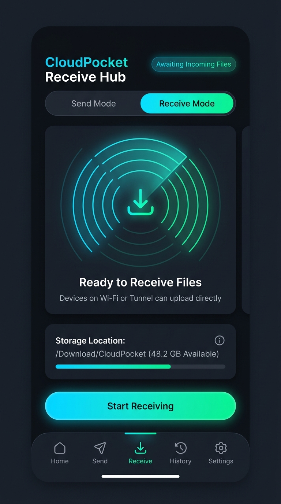

# Screen 03: Dedicated Receive Mode & Drop-Zone



## 1. Overview & Architectural Role
**Receive Mode** ([`SessionNotifier.setIsReceiveMode(true)`](file:///f:/Project/CloudPocket/lib/providers/session_provider.dart#L100)) transforms CloudPocket into a high-capacity incoming file ingestion station. 

Unlike traditional file-sharing utilities where receiving files requires reciprocal app installations, CloudPocket turns the host Android phone into a high-speed HTTP upload server. Any phone, laptop, desktop, or tablet on the same Wi-Fi network (or anywhere in the world via Cloudflare tunnel) can navigate to the portal and upload files directly into the host's download storage without installing any software.

---

## 2. Strict Blast-Radius & State Isolation Rules

> [!IMPORTANT]
> **Zero-Residual Leak Protection**:
> As verified in `receive_mode_and_tunnel_toggle_test.dart`, toggling `Receive Mode` executes:
> 1. `session.items.clear()`: Guarantees that any private files staged earlier in Send Mode are purged from memory immediately.
> 2. `FileHandler.listFiles()` returns an empty array `items: []`, ensuring connected clients cannot browse or download host files while the host is in Receive Mode.
> 3. `session.allowUploads = true`: Unlocks the `/api/upload` endpoint and activates the web drop-zone.

---

## 3. Visual Hierarchy & UI Breakdown

### 3.1 Receive Mode Hub Header
- **Active Receive Banner**: Displays an emerald cyan pill reading *"Awaiting Incoming Files"*.
- **Listening Interface**: Shows the network interface where the receiver is listening (e.g., `Wi-Fi: 192.168.1.42:8080`).

### 3.2 Radar / Drop-Zone Visualizer
- **Pulsing Animation**: A concentric radar pulse animation centered around a cloud-download vector icon.
- **Explanatory Typography**: 
  - Title: *"Ready to Receive Files"*
  - Subtitle: *"Devices connected to this Wi-Fi network or public tunnel can open the web link and upload photos, videos, archives, and folders directly to your device."*

### 3.3 Target Storage & Capacity Meter
- **Directory Path**: Displays the destination storage directory: `/Download/CloudPocket/`.
- **Free Storage Bar**: A visual progress bar detailing available disk storage on the host device (e.g., `48.2 GB Available of 128 GB`).
- **Warning State**: Turns amber if available disk storage falls below 1 GB, preventing unexpected filesystem write failures.

### 3.4 Upload Configuration Options
- **Optional Upload PIN**: Allows the host to set an upload access code so unauthorized network peers cannot spam the device with unwanted files.
- **Auto-Rename on Collision**: Explains that files with identical filenames will automatically receive numeric suffixes (e.g., `Photo (1).jpg`) to prevent accidental overwrites.

### 3.5 Primary Action Trigger
- **Start Receiving Button**: A wide, glowing gradient pill button (`#00B0FF` to `#00E676`). Tapping this starts the server and presents the live receiving dashboard.

---

## 4. End-to-End Upload Architecture

```mermaid
flowchart LR
    ClientBrowser["Client Web Browser<br/>(Drop-Zone Drag & Drop)"] -->|Chunked POST /api/upload| ShelfServer["Shelf HTTP Server<br/>(Zero-Buffer Pipe)"]
    ShelfServer -->|request.read() stream| IOSink["IOSink Direct Stream"]
    IOSink -->|Filesystem write| TargetStorage["/Download/CloudPocket/<br/>(Internal Storage)"]
    TargetStorage -->|Notification Event| ReceivedNotifier["ReceivedFilesProvider<br/>(Live UI Update)"]
```
- **Zero-Buffer RAM Guarantee**: CloudPocket never buffers multi-gigabyte uploads in device RAM (which would trigger the Android Low Memory Killer). Files stream directly from the incoming TCP socket into the storage `IOSink`.
