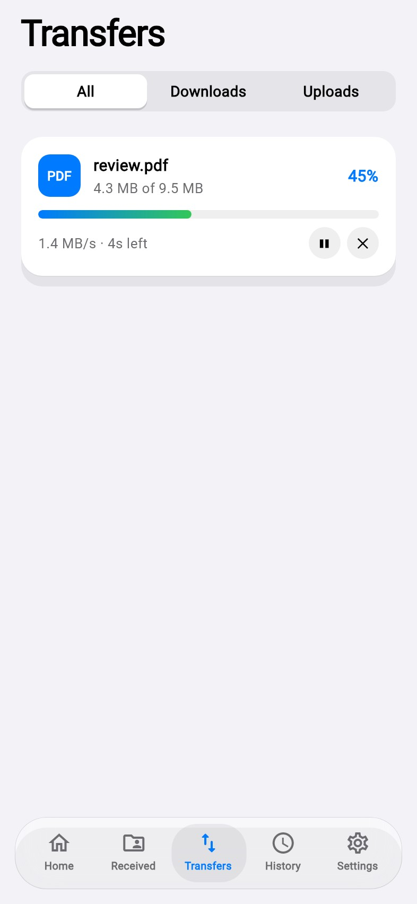

# Screen 04: Transfers & Bandwidth Dashboard (Tab 2)

## 1. Overview & Architectural Role
The **Transfers Dashboard** ([`TransfersTab`](../../lib/ui/screens/transfers_tab.dart)) is the second tab in the main curved navigation bar. It acts as an interactive real-time mission control for all active and recently completed file uploads and downloads between the host device and web clients.

It provides visual metrics for throughput, ETA estimations, transfer directions (upload vs. download), client IP associations, and granular control (pause, resume, cancel).

---

## 2. Visual Hierarchy & UI Breakdown

### 2.1 Top App Bar & Live Bandwidth Metric
- **Header Title**: *"Active Transfers"*
- **Aggregate Speedometer Chip**: Displays simultaneous aggregate throughput for both upstream and downstream:
  - `28.4 MB/s ▾` (Incoming downloads into host)
  - `12.1 MB/s ▴` (Outgoing uploads served to web clients)
- **Clear All Button**: Icon button on the app bar allowing the user to clear completed or dismissed transfer records with a single tap.

### 2.2 Category & Status Filter Pills
Located directly beneath the header are filter chips:
- `All (3)`: Shows entire queue of current and recent transfers.
- `Uploading (2)`: Filters specifically for active outgoing streams to clients.
- `Receiving (0)`: Filters for incoming files being written to host storage.
- `Completed (1)`: Displays transfers that finished successfully with 100% integrity checks.

### 2.3 Transfer Card Anatomy
Each item in the transfer list is rendered as a clean dark slate card with:
1. **File Type Icon & Badge**:
   - Distinctive colored badge based on MIME type: Blue for Documents/PDFs, Magenta for Videos, Amber for Archives/ISOs, Green for Images.
2. **File Title & Size**:
   - Filename with middle-truncation for long names (e.g., `Ubuntu_24.04_...desktop-amd64.iso`).
   - Total file size and transferred bytes (e.g., `2.95 GB / 4.10 GB`).
3. **Smooth Animated Progress Bar**:
   - Modern rounded progress indicator with continuous linear easing.
   - Dynamic color: Electric cyan during active transfer, emerald green upon 100% completion, crimson upon error or cancellation.
4. **Speed & ETA Telemetry**:
   - Instantaneous transfer speed (e.g., `18.5 MB/s`).
   - Calculated Estimated Time of Arrival (e.g., `ETA: 48s`).
5. **Client Attribution**:
   - Displays which connected client IP is initiating or receiving the transfer (e.g., `Client: 192.168.1.55`).
6. **Action Controls**:
   - **Pause / Resume Pill**: Toggles byte-stream throttling or pauses range requests.
   - **Cancel / Close (X) Icon**: Aborts the active socket stream and removes partial temporary files.

### 2.4 Empty Queue State
When no transfers are currently active, the tab displays an elegant empty state:
- Illustrated bidirectional arrows graphic.
- Caption: *"No Active Transfers"*.
- Subtitle: *"Files uploaded by browser clients or downloaded from your shared library will appear here in real time."*

---

## 3. UX Performance & Memory Safeguards

- **Isolate-Free UI Smoothness**: Bandwidth calculations are throttled using a 250ms debouncer in [`TransfersNotifier`](../../lib/providers/transfers_provider.dart) to ensure that high-speed Wi-Fi 6 transfers (up to 80+ MB/s) do not stutter the Flutter 120Hz UI rendering loop.
- **Haptic Confirmations**: Soft haptic ticks when transfers complete successfully.
