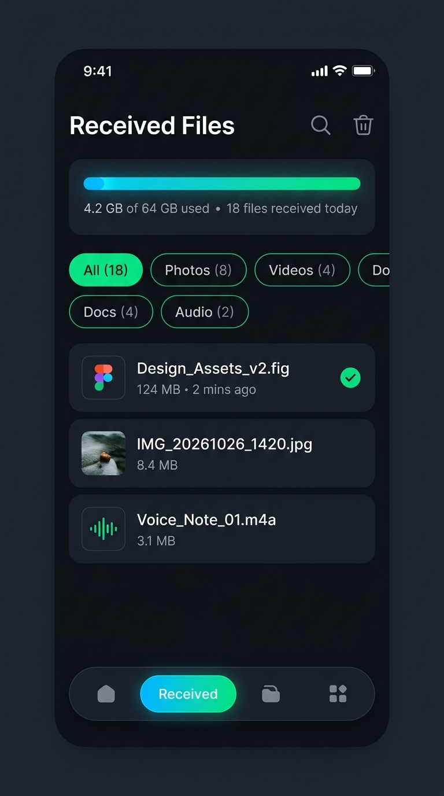
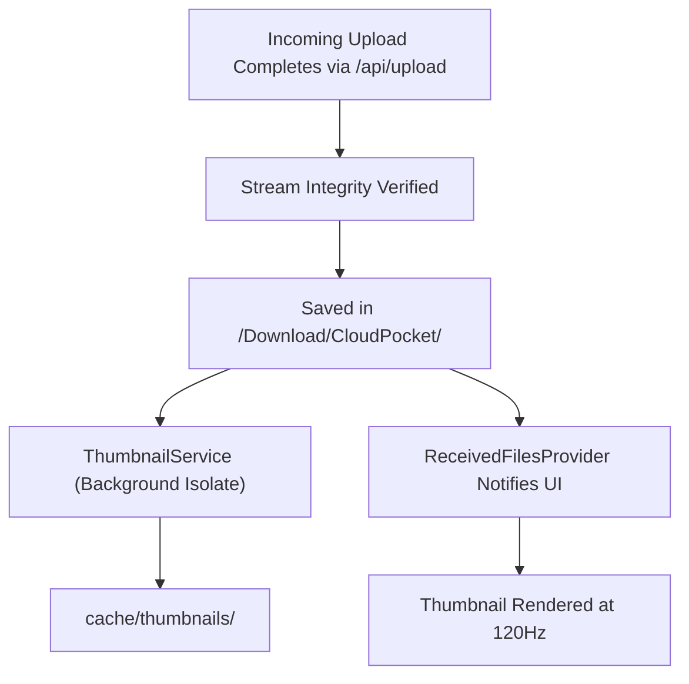

# Screen 05: Received Files Manager & Storage Browser (Tab 1)

## 1. Overview & Architectural Role
The **Received Files Manager** ([`ReceivedFilesTab`](file:///f:/Project/CloudPocket/lib/ui/screens/received_files_tab.dart#L20-L750)) is the dedicated file repository tab in the navigation bar. Whenever external users upload files through the web portal (whether in local Wi-Fi Receive Mode or via Cloudflare quick tunnel), the files are ingested into the device's storage directory (`/Download/CloudPocket/`) and immediately indexed here.

This screen provides complete management capabilities: visual file previews, thumbnail generation, category filtering, search, native viewing, external sharing, and batch deletion.

---

## 2. Visual Hierarchy & UI Breakdown

### 2.1 Top App Bar & Management Actions
- **Header Title**: *"Received Files"*
- **Search Bar / Toggle**: Tapping the search icon slides open an instant in-memory text filter for finding files by name or extension.
- **Batch Selection Mode**: Tapping the select-all icon allows selecting multiple files for batch deletion or archiving.

### 2.2 Storage Breakdown Card
An informative summary banner positioned at the top of the feed:
- **Visual Storage Meter**: A sleek horizontal progress bar illustrating total disk utilization.
- **Metric Labels**: Displays metrics such as `4.2 GB of 64 GB used • 18 files received today`.
- **Target Folder Link**: Quick shortcut showing `Saved to: /storage/emulated/0/Download/CloudPocket`.

### 2.3 Category Filter Pills
Interactive horizontal filter pills with live item count badges:
- `[All (18)]`: Comprehensive chronological feed.
- `[Photos (8)]`: JPEGs, PNGs, WebPs, HEICs, GIFs.
- `[Videos (4)]`: MP4, MKV, MOV, WebM.
- `[Docs (4)]`: PDF, DOCX, XLSX, TXT, MD.
- `[Audio (2)]`: MP3, M4A, FLAC, WAV, AAC.

### 2.4 File Item Anatomy (List & Grid Layouts)
Each file card contains:
1. **Interactive Thumbnail**:
   - For images and videos, generated asynchronously on a background isolate via [`ThumbnailService`](file:///f:/Project/CloudPocket/lib/server/thumbnail_service.dart) and cached on disk.
   - For documents, audio, and archives, displays high-contrast custom vector glyphs.
2. **Metadata Cluster**:
   - Primary line: File name with extension.
   - Secondary line: Exact human-readable file size (e.g., `124 MB`) + relative arrival timestamp (e.g., `2 mins ago`).
3. **Status Checkmark**: Indicates file hash verification was completed upon upload.
4. **Three-Dot Action Menu**:
   - **Open File**: Invokes native Android viewer via `open_filex`.
   - **Share**: Opens Android share-sheet (`share_plus`).
   - **Copy to Clipboard / Path**: Copies filesystem path.
   - **Delete**: Safely removes the file from disk and triggers an undo snackbar.

### 2.5 Empty State
If no files have been received yet:
- Clean folder graphic with dashed borders.
- Header: *"No Received Files Yet"*.
- Subtitle: *"Switch to Receive Mode on the Home screen to accept files from other phones or computers."*
- Direct CTA: *"Go to Receive Mode"*.

---

## 3. Storage Security & File Integrity

- **Zero Path Traversal Vulnerabilities**: All incoming file names are sanitized to strip relative directory prefixes (`../` or `..\\`), preventing any malicious upload from writing outside the designated `/Download/CloudPocket/` sandbox.
