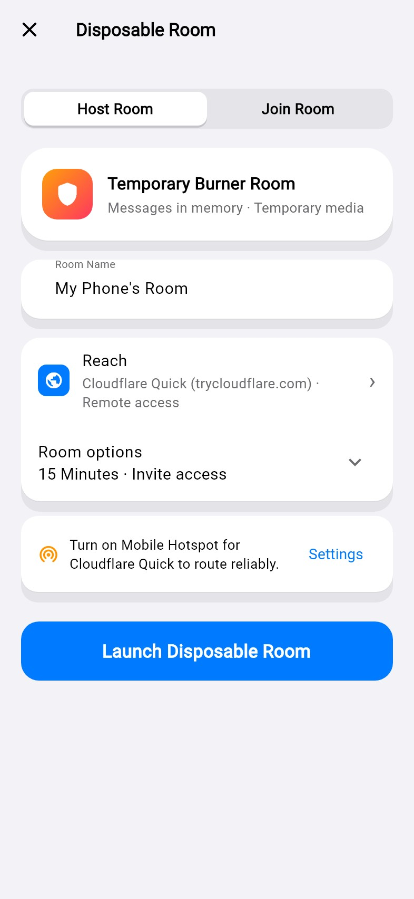
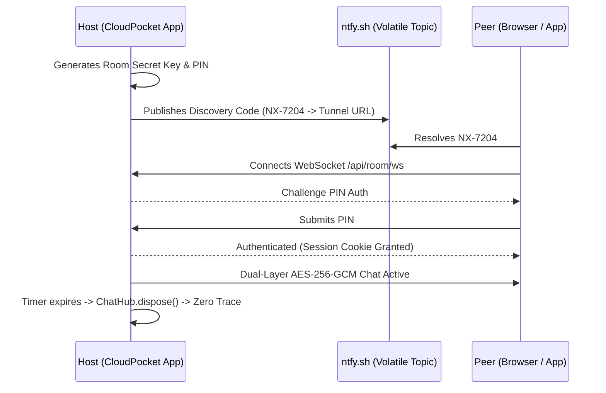

# Screen 06: Disposable Chat Room Setup & Live Hub

## 1. Overview & Architectural Role
The **Disposable Chat Room Setup & Live Hub** ([`DisposableRoomSetupScreen`](../../lib/ui/screens/disposable_room_setup_screen.dart) and [`DisposableRoomLiveView`](../../lib/ui/screens/disposable_room_live_view.dart)) delivers an ephemeral, privacy-first peer-to-peer communication experience.

Disposable Rooms are designed for zero-trace file and text exchange. Unlike standard messaging platforms that store conversations indefinitely in the cloud or phone databases, CloudPocket's Disposable Room operates **strictly in RAM inside `ChatHub`**. Nothing is ever committed to SQLite, `SharedPreferences`, or device flash storage. When the room expires or the user taps "Terminate", the chat messages vanish completely.

---

## 2. Visual Hierarchy & UI Breakdown

### 2.1 Tabbed Interface (Host vs. Join)
The setup screen features two distinct operating tabs:
1. **Host a Room**: Configure and initiate an ephemeral session on this phone.
2. **Join a Room**: Connect as a client to a room hosted on another device.

---

### 2.2 Host Configuration Controls
- **Room Duration Slider & Presets**:
  - Horizontal preset chips: `5 min`, `15 min`, `30 min`, `1 hr`, `2 hr`, `24 hr`.
  - Explanatory note: *"Room automatically self-destructs and purges all media once the timer reaches zero."*
- **PIN Security Toggle**:
  - Switch enabling an optional 4-digit PIN.
  - Generates a cryptographically random PIN by default, or allows host custom input.
  - Strict security guarantee: If `requirePin` is set, no user can enter via URL token without also entering the correct PIN.
- **End-to-End Encryption Badge**:
  - Displays an emerald shield badge: *"Dual-Layer AES-256-GCM Encrypted"*.
  - Explains that text messages and media attachments are encrypted on the sending device before entering the WebSocket stream, and decrypted exclusively in the recipient's volatile memory.
- **Launch Action**: Glowing crimson-cyan button reading **"Create Disposable Room"**.

---

### 2.3 Join Room Controls
- **Manual Room Input**: Text fields for entering the Room URL or IP address, along with the optional PIN.
- **Dynamic 6-Character Discovery Code**:
  - CloudPocket supports ephemeral room discovery via lightweight `ntfy.sh` topics using 6-character codes (e.g., `NX-7204`).
  - Entering this code automatically resolves the host's tunnel URL without requiring manual typing of long URLs.
- **Camera QR Scanner Button**: Launches [`QrScannerSheet`](../../lib/ui/widgets/qr_scanner_sheet.dart) with a live camera viewfinder and corner target reticle to decode room URLs and embedded PINs instantly.
- **Clipboard Auto-Detection**: Automatically detects any copied CloudPocket room URL on the system clipboard and pre-fills the input field.

---

### 2.4 Active Room Live Hub (`DisposableRoomLiveView`)
Once a room is active, the host is presented with a cyberpunk-inspired security console:
1. **Circular Countdown Dial**:
   - A glowing countdown ring with amber-crimson gradient showing time remaining (e.g., `14:59`).
   - Pulsing self-destruct warning icon.
2. **Room Identity Card**:
   - 6-character discovery code chip (`NX-7204`) with a quick copy button.
   - Room PIN badge (`PIN: 8492`).
3. **Connected Peers List**:
   - Real-time roster showing connected clients (e.g., `Host (You)`, `Safari / iPhone 15`, `Chrome / MacBook`).
4. **Primary CTAs**:
   - **Enter Live Chat**: Navigates to [`RoomChatScreen`](../../lib/ui/screens/room_chat_screen.dart).
   - **Terminate & Shred Room Now**: Red button that triggers immediate teardown, unlinks the temporary cache directory (`cache/disposable_room/`), and wipes the RAM message buffer.

---

## 3. Cryptographic & Lifecycle Flow

