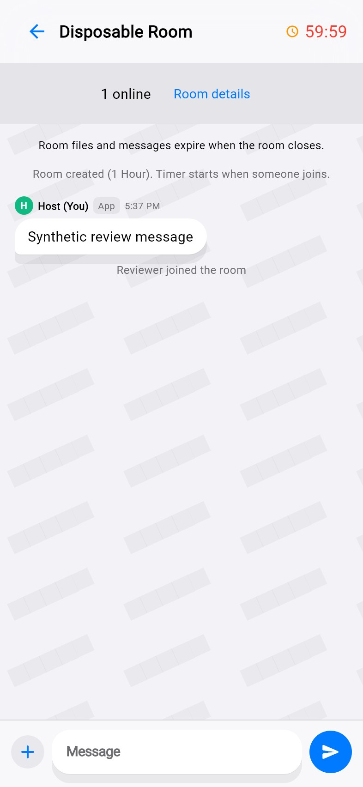
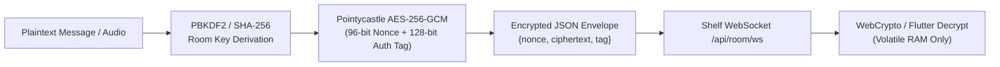

# Screen 07: Ephemeral Room Chat Timeline & In-Memory Media

## 1. Overview & Architectural Role
The **Room Chat Screen** ([`RoomChatScreen`](../../lib/ui/screens/room_chat_screen.dart)) provides the live messaging and media exchange experience within a disposable room.

Engineered from the ground up to prevent data retention, this interface is backed entirely by an in-memory WebSocket pipeline in [`ChatHub`](../../lib/server/chat_hub.dart). No message bubbles, voice notes, photos, or documents are ever saved to device storage or databases.

---

## 2. Visual Hierarchy & UI Breakdown

### 2.1 Top App Bar & Security HUD
- **Room Identity**: Displays active Room Discovery ID (e.g., `Room: NX-7204`).
- **Countdown Timer Pill**: Shows the live remaining room lifespan in red digits with a pulsing circular indicator (e.g., `12:34`).
- **Encryption Shield Indicator**: Tapping the green lock icon displays a security modal detailing the AES-256-GCM cipher parameters and SHA-256 room key derivation.
- **Participant Counter**: Displays live count of active peers in the session.

### 2.2 Security Notice Banner
Pinned above the chat timeline is an informative banner:
- Icon: Shield with padlock.
- Text: *"RAM-Only Ephemeral Session: Messages and media will never touch flash storage or leave a forensic footprint."*

### 2.3 Timeline & Message Bubbles
- **System Event Bubbles**: Centered subtle gray capsules reporting participant joins, leaves, and countdown warnings (e.g., *"Peer 'Safari/iPhone' joined the room using PIN verified auth."*).
- **Outgoing Text Bubbles**: Deep slate-cyan cards aligned right with tiny checkmarks indicating delivery.
- **Incoming Text Bubbles**: Dark slate cards aligned left with the sender's nickname chip.
- **Hardware-Secured Media Attachments**:
  - Image attachments are rendered with blurred placeholders and an overlay lock icon reading: *"Tap to open in Hardware-Secured Viewer"*.
  - Voice notes display custom interactive waveform players with duration counters (e.g., `0:14 • Ephemeral Voice Note`).
  - Documents (PDFs, TXT) display a view-only tag with download actions strictly disabled.

### 2.4 Bottom Encrypted Input Bar
- **Attachment Trigger (+ / Camera)**: Opens a bottom sheet to snap an ephemeral camera photo or pick a document. Files are encrypted client-side in RAM before dispatch.
- **Message Input Field**: Pill-shaped dark input field reading *"Message ephemeral room..."*.
- **E2E Security Tag**: Shows a tiny green badge `E2E GCM` confirming hardware keystore acceleration.
- **Send Button**: Glowing cyan circle with paper plane icon. Haptic feedback fires upon transmission.

---

## 3. Cryptographic Pipeline (AES-256-GCM)

All messages and media transferred across the WebSocket connection follow this pipeline:

> [!IMPORTANT]
> **Zero Unauthenticated Bit-Flipping**:
> Unlike legacy AES-CBC ciphers, the AES-256-GCM implementation generates a 128-bit authentication tag. Any attempt to tamper with or flip bits in the ciphertext during network transit causes immediate authentication rejection before the message can be processed.
