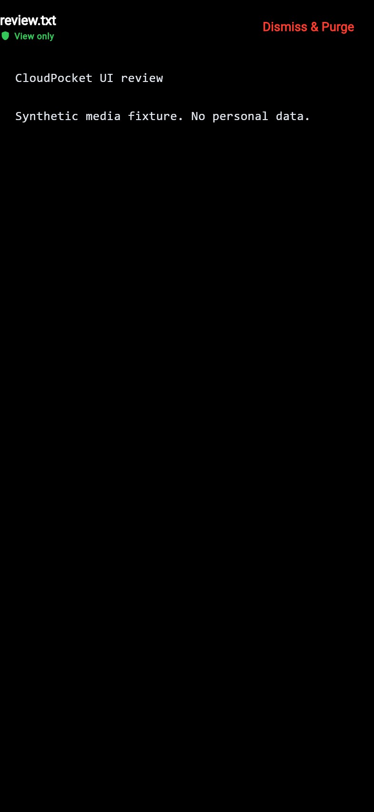

# Viewing room attachments

Tap an attachment in a disposable room to open the in-app viewer. Images support zoom, PDFs have page controls, and text and Markdown files open as readable text. Closing the viewer returns to the conversation.

The Android viewer requests secure-window protection against screenshots and screen recording on supported devices. The gallery image comes from a Flutter widget test. It illustrates the layout and does not verify capture protection on a phone.

The viewer omits save and export actions. Some formats need a temporary file for playback or rendering. A recipient can still photograph the display, and browser clients have different capture limits. [Viewer implementation](../../lib/ui/widgets/room_media_viewer.dart) · [Security model](../../docs/SECURITY.md)
