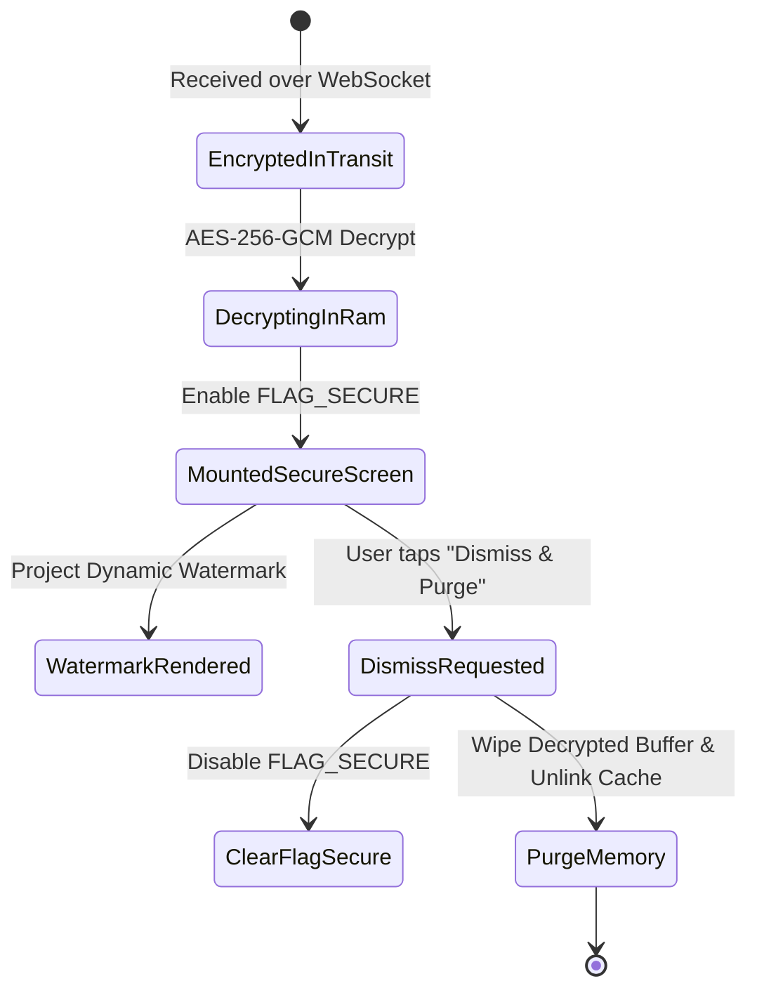

# Screen 08: Hardware-Secured Media Viewer & FLAG_SECURE Guard


## 1. Overview & Architectural Role
The **Hardware-Secured Media Viewer** ([`RoomMediaViewerScreen`](file:///f:/Project/CloudPocket/lib/ui/widgets/room_media_viewer.dart#L25-L650)) is a high-security visual presentation screen tailored specifically for sensitive documents, schematics, photos, audio, and video shared within Disposable Rooms.

Its objective is to prevent data extraction, screenshot capture, screen recording, and unauthorized persistent downloads by enforcing both operating system hardware flags and client-side anti-capture countermeasures.

---

## 2. Hardware & OS-Level Safeguards

### 2.1 Android Window Manager `FLAG_SECURE`
When `RoomMediaViewerScreen` is mounted, CloudPocket invokes native Android channel methods in [`MainActivity.kt`](file:///f:/Project/CloudPocket/android/app/src/main/kotlin/com/cloudpocket/app/cloud_pocket/MainActivity.kt#L125):
```kotlin
window.setFlags(
    WindowManager.LayoutParams.FLAG_SECURE,
    WindowManager.LayoutParams.FLAG_SECURE
)
```
- **Screenshot Prevention**: The Android operating system blocks all screenshot attempts. Any system screenshot shortcut (e.g., Power + Volume Down) produces a black image or an OS toast reading *"Can't take screenshot due to security policy"*.
- **Screen Recording Protection**: Video screen recorders (built-in or third-party) capture only a black screen.
- **Recent Apps / App Switcher Concealment**: When the user navigates to Android's Recent Apps view, the OS conceals the app thumbnail with a solid privacy blank card to prevent shoulder-surfing.
- **Automatic Flag Teardown**: The instant the user dismisses the viewer, `FLAG_SECURE` is safely cleared so other standard screens (like QR codes) can be shared normally.

---

## 3. Visual Hierarchy & UI Breakdown

### 3.1 Transparent Header & Security Tag
- **Protected Header**: Displays the filename (e.g., `CONFIDENTIAL_ARCH_DIAGRAM.png`).
- **Hardware Security Badge**: A bold red badge with a crossed-out camera icon reading:
  `HARDWARE PROTECTED (FLAG_SECURE)`.

### 3.2 Dynamic Volatile Watermark Overlay
- To prevent external phone-to-screen photography attacks, the viewer projects a subtle, semi-transparent diagonal watermark grid across the entire canvas:
  `CLOUDPOCKET • DISPOSABLE • NO CAPTURE • 2026-10-26 • 192.168.1.55`
- The watermark dynamically incorporates the user's IP address and session timestamp, discouraging offline redistribution.

### 3.3 Media Presentation Canvas
- **Pinch-to-Zoom & Pan**: Smooth multi-touch gesture canvas powered by `InteractiveViewer`.
- **Integrated Viewers**:
  - **Images**: High-resolution bitmap decoded directly from memory bytes into an Skia texture.
  - **PDF Documents**: Rendered page-by-page via native `PdfRenderer` on Android without writing intermediate PDF files to user-accessible directories.
  - **Video & Audio**: Inline hardware player with download buttons and context menus completely stripped.

### 3.4 Floating Security HUD & Dismiss Trigger
- **Security Notice Card**: A semi-transparent dark card docked at the bottom of the screen:
  *"Protected View-Only Mode: Screen capture is disabled by Android OS. File is stored in volatile RAM cache and will unlink immediately upon closing."*
- **Dismiss & Purge Button**: A glowing red pill button. Tapping it terminates the viewer, triggers a memory wipe of the decrypted bytes, and unlinks any temporary decrypted file handles from the filesystem cache.

---

## 4. Lifecycle & Immediate Memory Unlink


