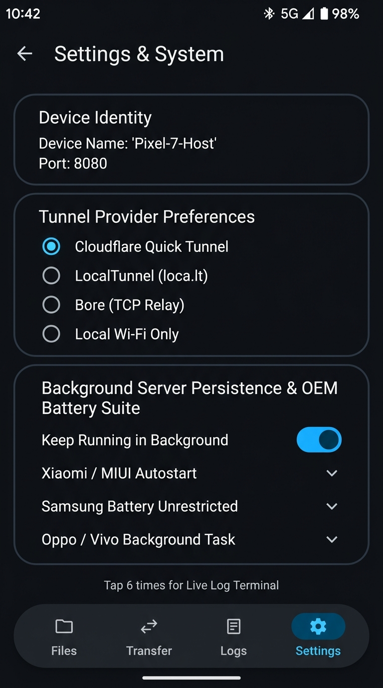
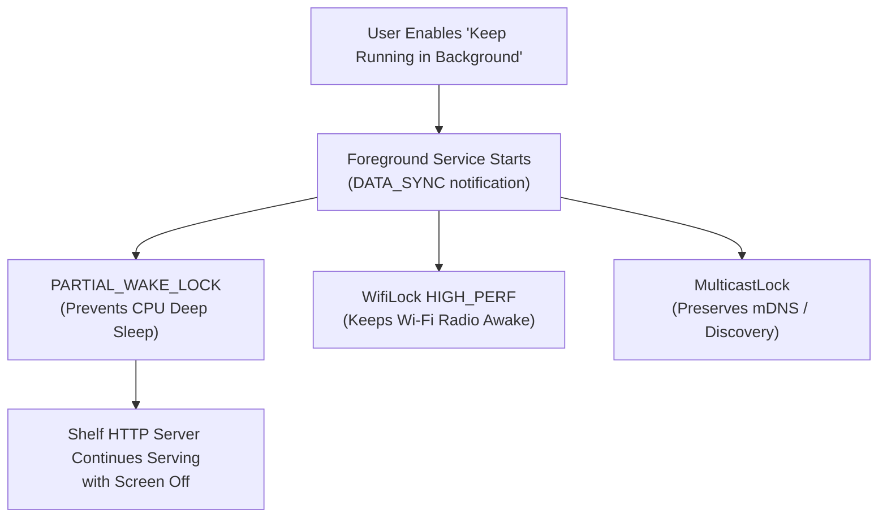

# Screen 09: Settings & OEM Background Suite (Tab 4)

## 1. Overview & Architectural Role
The **Settings & OEM Suite** ([`SettingsTab`](file:///f:/Project/CloudPocket/lib/ui/screens/settings_tab.dart#L25-L650)) is the fifth tab in the navigation bar. It houses server identity configurations, networking preferences, battery optimization overrides, OEM-specific task kill prevention guides, and diagnostic utilities.

Because Android vendors aggressively kill background processes and close open server sockets when the phone screen turns off, this screen features specialized OEM integration to keep CloudPocket running uninterrupted.

---

## 2. Visual Hierarchy & UI Breakdown

### 2.1 Top App Bar & Device Identity
- **Header**: *"Settings & System"*
- **Device Identity Card**:
  - **Device Name Input**: Customizes the broadcast name visible to connected browsers (e.g., `Pixel-7-Host`).
  - **Server Port Config**: Allows overriding the default port `8080` (with validation for ports between `1024` and `65535`).

### 2.2 Tunnel Provider Preference
Radio selection card for choosing default tunneling behavior:
- `Cloudflare Quick Tunnel` *(Recommended)*: Zero-config public HTTPS URL via Cloudflare edge.
- `LocalTunnel (loca.lt)`: Pure Dart multiplexed TCP pool.
- `Bore (TCP Relay)`: Lightweight VPS tunnel.
- `Local Wi-Fi Only`: Strict air-gapped mode that rejects external internet tunnels.

### 2.3 Background Server Persistence & OEM Battery Suite
Mobile operating systems employ aggressive low-power daemons that sever active Wi-Fi connections when the screen sleeps. CloudPocket combats this via a multi-tiered architecture:
1. **Background Service Switch**:
   - Toggles Android Foreground Service (`flutter_foreground_task`) with persistent notification.
   - Automatically acquires `PARTIAL_WAKE_LOCK`, `WIFI_MODE_FULL_HIGH_PERF`, and `MulticastLock`.
2. **OEM-Specific Bypass Cards**:
   CloudPocket provides customized guidance cards that launch directly into manufacturer-specific settings screens via native Android intents in [`MainActivity.kt`](file:///f:/Project/CloudPocket/android/app/src/main/kotlin/com/cloudpocket/app/cloud_pocket/MainActivity.kt):
   - **Xiaomi / Redmi / POCO (MIUI / HyperOS)**: Auto-start permission intent (`com.miui.securitycenter`).
   - **Samsung (One UI)**: App Battery Usage -> *"Unrestricted"* intent.
   - **Oppo / Realme / OnePlus (ColorOS / OxygenOS)**: Allow Background Activity intent.
   - **Vivo / iQOO (Funtouch OS)**: Background Power Consumption intent.
   - **Huawei / Honor (EMUI)**: App Launch -> *"Manage Manually"* intent.

### 2.4 Diagnostics & Secret Log Viewer
- **Footnote**: Displays app version (`v1.5.0+1`), Dart SDK, and build architecture (`arm64-v8a`).
- **Secret Easter Egg UX**: Tapping the Settings icon 6 times in rapid succession triggers a medium haptic pulse and summons [`LogViewerDialog`](file:///f:/Project/CloudPocket/lib/ui/widgets/log_viewer_dialog.dart). This dialog displays a live in-memory terminal buffer of all Shelf server requests, tunnel connection logs, DNS lookups, and crypto events without writing secrets to persistent log files.

---

## 3. Background Architecture Flow

