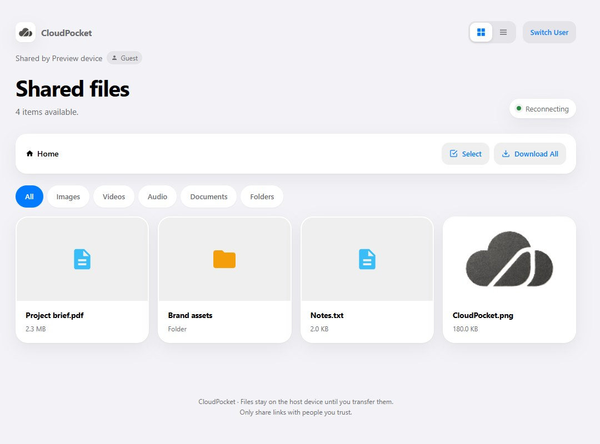
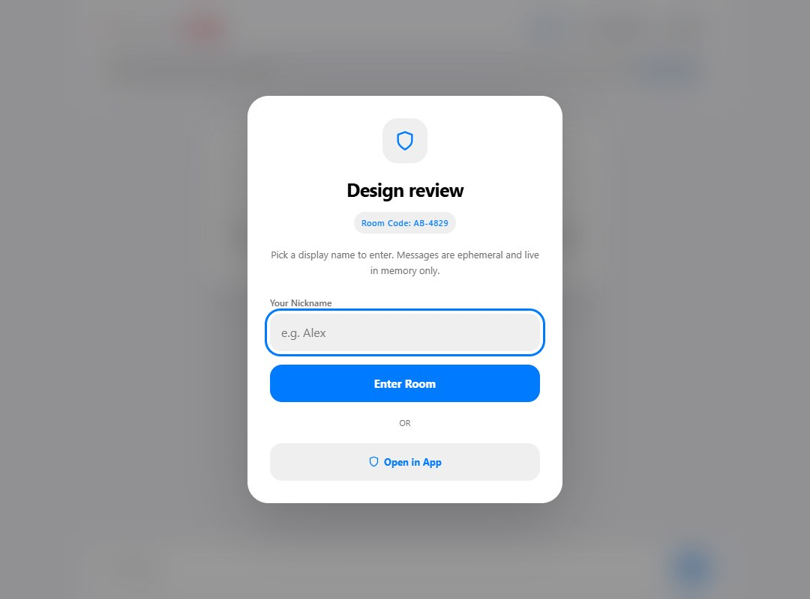

# Screen 10: Web Client Portals (Browser Client Experience)

## 1. Overview & Architectural Role
The **Web Client Portals** ([`assets/web/`](../../assets/web)) are the browser-rendered frontends served directly by CloudPocket's embedded Shelf server to any client device that visits the host's IP or tunnel URL.

Because client devices do not install an app, the web interface must deliver an AirDrop-like, frictionless experience across mobile Safari (iOS), Google Chrome (Android/Windows/Mac), Microsoft Edge, and Firefox.

The web suite consists of two distinct portals:
1. **File Transfer Portal** (`index.html`, `styles.css`, `app.js`): For downloading host files and uploading client files.
2. **Disposable Room Portal** (`room.html`, `room.css`, `room.js`): For joining ephemeral end-to-end encrypted chat sessions.

---

## 2. File Sharing Portal UI/UX (`index.html`, `app.js`)

### 2.1 Visual Hierarchy & Design System
- **Theme**: Dark glassmorphic modern palette (`#0F172A` deep navy, `#1E293B` card slate, electric cyan `#00B0FF` accents).
- **Header**:
  - Host identity badge: *"Connected to Pixel-7-Host"*.
  - Live connection status pill: *"Online (Direct Wi-Fi / Tunnel)"*.

### 2.2 Send Mode View (Downloading from Host)
- **Batch Action**: **"Download All as ZIP"** button. Streams all staged files dynamically using [`ZipStreamer`](../../lib/server/zip_streamer.dart) without staging a giant ZIP file on host disk.
- **File Cards**:
  - Thumbnail previews for images, vector icons for documents/media.
  - Filename, size in MB/GB, and download count badge.
  - Individual "Download" button supporting resume/range requests (HTTP 206 Partial Content).

### 2.3 Receive Mode View (Uploading to Host)
- **Full-Page Drag-and-Drop Zone**: Users can drag files or entire folders from desktop file explorers directly onto the browser window.
- **Folder Batch Upload**: Automatically recurses nested directory structures via HTML5 WebKit directory upload API.
- **Chunked Progress Bars**: Uploads stream via `request.read() -> IOSink` with live percentage indicators, ETA, and speedometers.

---

## 3. Disposable Room Web Portal (`room.html`, `room.js`)

### 3.1 Authentication & PIN Screen
- If the host configured a PIN, unauthenticated clients are greeted with an encrypted entry modal.
- Submitting the PIN verifies with `/api/room/auth` and receives an ephemeral, secure session cookie.

### 3.2 Dynamic Watermark & Anti-Capture DOM Protection
- **Dynamic Background Watermark**: A client-side canvas dynamically tiles the recipient's IP address and current UTC timestamp across the window to deter external camera photography.
- **Context Menu Suppression**: `document.addEventListener('contextmenu', e => e.preventDefault())` disables right-click *"Save Image As"*.
- **Print Suppression CSS**: `@media print { body { display: none !important; } }` renders a blank page if a user attempts to print or PDF-export the chat.
- **Media Controls Guard**: Audio and video players enforce `controlsList="nodownload"` to strip browser download buttons.

### 3.3 WebCrypto End-to-End Cryptography
- Implements authenticated **AES-256-GCM** using the browser's native `window.crypto.subtle` API.
- Nonces (96-bit) and authentication tags (128-bit) are validated on every incoming packet.
- In-browser media viewer displays images and documents in volatile blob memory URLs (`blob:http...`), which are immediately revoked (`URL.revokeObjectURL`) when the modal closes.

---

## 4. Web vs. Native Feature Comparison

| Capability | Native Android App (Host) | Web Client (Receiver / Peer) |
| :--- | :--- | :--- |
| **Installation Requirement** | APK / Native Flutter App | Zero install (Any modern browser) |
| **Screenshot Prevention** | Hardware OS `FLAG_SECURE` | Dynamic Watermark + CSS Guard |
| **File Range Requests (HTTP 206)**| Supported via Shelf `FileHandler`| Supported in browser media players |
| **Cryptography Engine** | Pointycastle Dart (AES-256-GCM) | WebCrypto SubtleCrypto (AES-256-GCM) |
| **RAM-Only Ephemeral State** | In-Memory `ChatHub` | In-Memory Web Workers / Blobs |
| **Dynamic ZIP Streaming** | `StreamingZipArchive` pipe | Native browser ZIP stream download |
