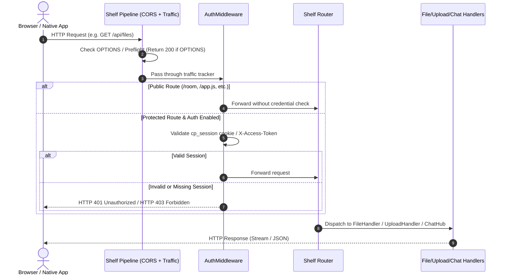
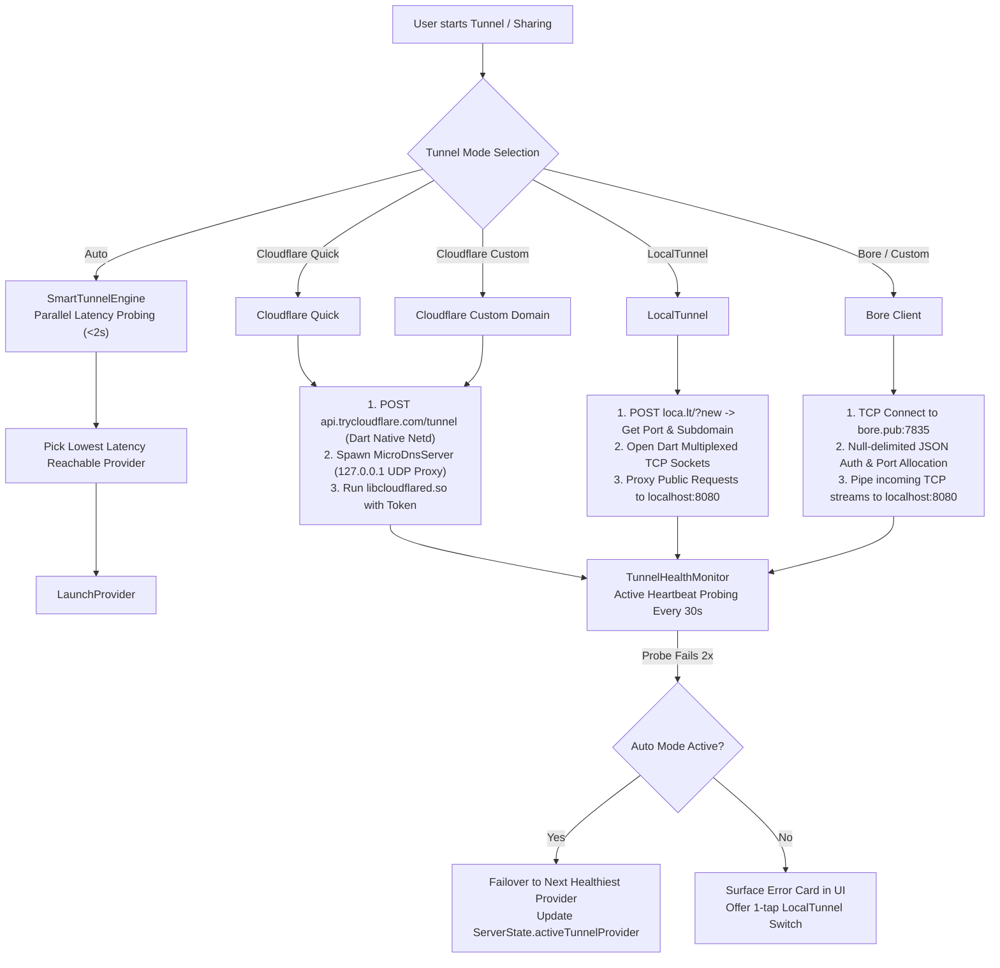
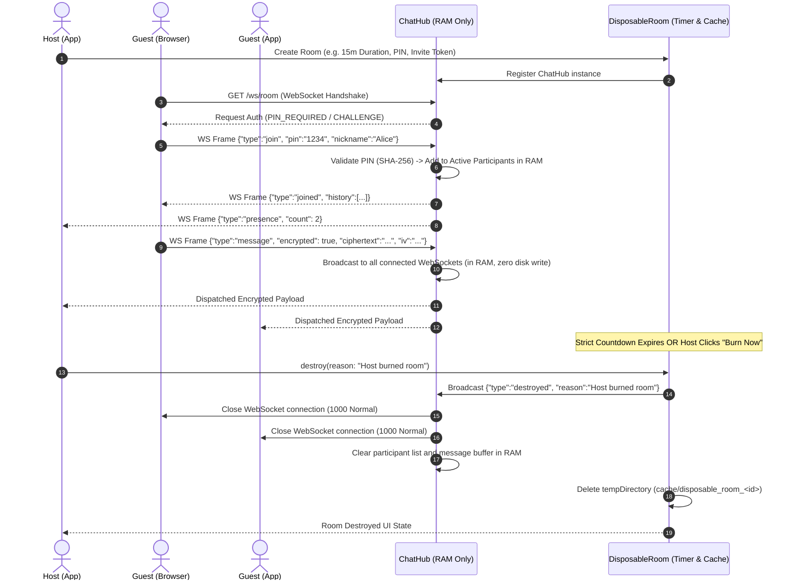

# CloudPocket — System Architecture & Component Design

This document provides the authoritative, verifiable architectural specification for the **CloudPocket** application (v1.5.0+1). It details the system topology, data flow, state management, networking subsystems, server lifecycle, and platform-specific integrations.

---

## 1. System Topology & High-Level Architecture

CloudPocket transforms an Android device into a dual-purpose server:
1. **Local & Remote File Sharing Server**: High-throughput file sharing with range requests, on-the-fly streaming ZIP compression, thumbnail generation, and Vault Mode download limits.
2. **Disposable Ephemeral Communication Hub**: Strict-countdown, RAM-only disposable chat rooms featuring dual-layer cryptography (TLS + client-side E2E), dynamic ephemeral Chat ID discovery, and two-tier screenshot protection.

```mermaid
graph TD
    subgraph Client Tier
        BrowserUser["Web Client (Desktop/Mobile Browser)\n• File Portal (/)\n• Disposable Room Portal (/room)"]
        NativeGuest["Native App Guest\n• RoomChatScreen (FLAG_SECURE)\n• QrScannerSheet\n• RoomDiscoveryService"]
    end

    subgraph Network & Ingress Tier
        LocalLAN["Local Wi-Fi / Hotspot (0.0.0.0:8080)"]
        CF["Cloudflare Quick Tunnel\n(trycloudflare.com / HTTPS + WSS)"]
        LT["LocalTunnel Relay\n(loca.lt / HTTPS + WSS)"]
        Bore["Bore Relay\n(bore.pub / Plaintext TCP)"]
    end

    subgraph Host Device (CloudPocket Android App)
        subgraph Native Platform Layer
            KotlinAct["MainActivity.kt (MethodChannels)\n• wifi_lock (Wifi/Wake/Multicast Locks)\n• security (FLAG_SECURE Window Management)\n• sharing_intent (Android Share Sheet / Deep Links)"]
            FGS["Foreground Service\n(flutter_foreground_task / dataSync Notification)"]
            NativeBin["Native Binaries\nlibcloudflared.so (arm64-v8a)"]
        end

        subgraph Embedded Server Layer (Shelf)
            ShelfEngine["ServerEngine (Port 8080)\nShelf Pipeline + Router + TrafficTracker"]
            AuthMid["AuthMiddleware\nCookie Validation & Google Sign-In"]
            FileH["FileHandler\nStreaming Byte Ranges & Directory Browsing"]
            UpH["UploadHandler\nZero-Buffer Stream -> Disk"]
            ZipH["ZipStreamer\nStreamingZipArchive Multi-file ZIP"]
            ThumbS["ThumbnailService\nBackground Isolate Image Pipeline"]
            VaultT["VaultTracker\nPer-File Download Limits"]
            ChatH["ChatHub\nIn-Memory WebSocket Message & Presence Hub"]
            DispR["DisposableRoom\nCountdown Timer, Sandbox Cache, Cleanup"]
        end

        subgraph Remote Tunneling Layer
            TunMgr["TunnelManager & TunnelHealthMonitor"]
            SmartEng["SmartTunnelEngine (Latency Prober)"]
            MicroDNS["MicroDnsServer (127.0.0.1 UDP Proxy)"]
            CFClient["CloudflareClient (Process Runner)"]
            LTClient["LocalTunnelClient (Dart TCP Pool)"]
            BoreClient["BoreClient (Dart JSON TCP Socket)"]
        end

        subgraph State Management Layer (Riverpod)
            ServerProv["serverProvider (ServerState)"]
            SessProv["sessionProvider (ShareSession)"]
            RoomProv["roomProvider (DisposableRoom State)"]
            TransProv["transfersProvider (Live Transfers)"]
            StatsProv["statsProvider (ServerStats)"]
            NetProv["networkProvider (IP & Connectivity)"]
            SetProv["settingsProvider (Preferences)"]
        end

        subgraph Storage Tier
            PublicStore["Android Public Storage\n/storage/emulated/0/Download/CloudPocket"]
            EphemeralCache["Sandboxed Room Cache\ncache/disposable_room_<id>/"]
            ThumbCache["Thumbnail Cache\ncache/thumbnails/"]
        end
    end

    BrowserUser -->|HTTPS / WSS / HTTP| CF & LT & Bore & LocalLAN
    NativeGuest -->|HTTPS / WSS / HTTP| CF & LT & Bore & LocalLAN
    LocalLAN & CF & LT & Bore --> ShelfEngine

    ShelfEngine --> AuthMid
    AuthMid --> FileH & UpH & ZipH & ThumbS & ChatH
    FileH --> VaultT & PublicStore
    UpH --> PublicStore
    ThumbS --> ThumbCache
    ChatH --> DispR
    DispR --> EphemeralCache

    TunMgr --> SmartEng & CFClient & LTClient & BoreClient
    CFClient --> MicroDNS & NativeBin
    ServerProv --> ShelfEngine & TunMgr
    FGS -.->|Keeps Process Alive| ShelfEngine
    KotlinAct -.->|Power / Wi-Fi Lock| FGS
```

---

## 2. Flutter UI & Riverpod State Management

The presentation layer is built with Flutter and structured around `flutter_riverpod` (v2.4.9) StateNotifier providers.

### 2.1 Provider Registry & Interactions

| Provider | File | State Type | Role & Responsibilities |
| :--- | :--- | :--- | :--- |
| `serverProvider` | [`lib/providers/server_provider.dart`](file:///f:/Project/CloudPocket/lib/providers/server_provider.dart) | `ServerState` | Controls the lifecycle of `ServerEngine` and `TunnelManager`. Resolves public and local upload directories, starts foreground services, acquires wake/Wi-Fi locks, and updates active URLs and latency. |
| `sessionProvider` | [`lib/providers/session_provider.dart`](file:///f:/Project/CloudPocket/lib/providers/session_provider.dart) | `ShareSession` | Stores current session configuration: selected files, PIN/password, Google auth requirement, Vault Mode settings, tunnel provider choice, and `RoomConfig`. |
| `roomProvider` | [`lib/providers/room_provider.dart`](file:///f:/Project/CloudPocket/lib/providers/room_provider.dart) | `DisposableRoom?` | Manages active disposable room state, countdown timer callbacks, manual "Burn Now" triggers, participant registry, and destruction propagation. |
| `transfersProvider`| [`lib/providers/transfers_provider.dart`](file:///f:/Project/CloudPocket/lib/providers/transfers_provider.dart)| `List<TransferRecord>`| Tracks active and completed uploads and downloads in real time with bytes transferred, total size, speed (bps), and status. |
| `statsProvider` | [`lib/providers/stats_provider.dart`](file:///f:/Project/CloudPocket/lib/providers/stats_provider.dart) | `ServerStats` | Aggregates bandwidth (bytes in/out, current upload/download speed), active WebSocket connection count, and visitor totals. |
| `networkProvider` | [`lib/providers/network_provider.dart`](file:///f:/Project/CloudPocket/lib/providers/network_provider.dart) | `NetworkState` | Monitors Wi-Fi and Cellular status via `connectivity_plus` and resolves local IP addresses (interfaces: `wlan0`, `ap0`, `eth0`). |
| `settingsProvider` | [`lib/providers/settings_provider.dart`](file:///f:/Project/CloudPocket/lib/providers/settings_provider.dart) | `SettingsState` | Persists user preferences: `deviceName`, default tunnel provider, default expiry duration, dark mode theme setting, and custom Bore VPS parameters via `shared_preferences`. |
| `historyProvider` | [`lib/providers/history_provider.dart`](file:///f:/Project/CloudPocket/lib/providers/history_provider.dart) | `List<ShareHistory>` | Persists logs of past file-sharing sessions to disk. |
| `thumbnailProvider`| [`lib/providers/thumbnail_provider.dart`](file:///f:/Project/CloudPocket/lib/providers/thumbnail_provider.dart)| `ThumbnailState` | Orchestrates background thumbnail generation preheating for shared image and video files. |

### 2.2 Navigation Hierarchy (`AppShell`)

`AppShell` ([`lib/ui/app_shell.dart`](file:///f:/Project/CloudPocket/lib/ui/app_shell.dart)) hosts an animated bottom navigation bar (`SmoothCurvedNavBar` wrapping `curved_navigation_bar`) switching across four main views:
1. **Home / Share Setup (`HomeScreen`)**: Central hub for selecting files, configuring security/vault modes, picking tunnel modes, starting the server, and launching Disposable Chat Rooms. When active, displays `SharingLiveView`.
2. **Live Transfers (`TransfersTab`)**: Real-time progress cards for all active uploads and downloads, with a live `SpeedSparkline` throughput graph.
3. **Received Files (`ReceivedFilesTab`)**: Explorer for files uploaded by web clients into the device's public `Download/CloudPocket` directory.
4. **Settings (`SettingsTab`)**: Configuration for device identity, default tunnel mode, network interfaces, battery optimization whitelist prompts, and Cloudflare custom credentials.

---

## 3. Embedded Server & HTTP Routing Pipeline

The embedded HTTP server runs on `shelf` (v1.4.1) bound to `0.0.0.0:8080` (or the configured port).

### 3.1 Shelf Pipeline & Middleware Order

Requests pass through an ordered Shelf pipeline in [`lib/server/server_engine.dart`](file:///f:/Project/CloudPocket/lib/server/server_engine.dart):
1. **`_corsMiddleware()`**: Appends standard CORS headers (`Access-Control-Allow-Origin: *`, `Access-Control-Allow-Methods`, `Access-Control-Allow-Headers`) and responds to HTTP `OPTIONS` preflight requests immediately with HTTP 200.
2. **`_trafficTrackerMiddleware()`**: Intercepts the request and response body streams, counting bytes read and written to compute real-time throughput metrics dispatched to `statsProvider`.
3. **`_authMiddleware()`**: Validates session cookies, query tokens, and authorization headers against the active `ShareSession` requirements. Bypasses authentication for public static assets (`/room`, `/room.js`, `/room.css`, `/styles.css`, `/app.js`, `/favicon.png`, `/logo.png`) and discovery endpoints.
4. **Shelf Router**: Resolves endpoints to their respective handler functions.



### 3.2 Complete HTTP Route Inventory

| Route | Method | Handler / Logic | Auth Required? | Purpose |
| :--- | :--- | :--- | :--- | :--- |
| `/` | `GET` | `_serveIndexHtml()` | No | Serves [`assets/web/index.html`](file:///f:/Project/CloudPocket/assets/web/index.html) (file sharing web client). |
| `/styles.css` | `GET` | Static asset resolver | No | Serves [`assets/web/styles.css`](file:///f:/Project/CloudPocket/assets/web/styles.css). |
| `/app.js` | `GET` | Static asset resolver | No | Serves [`assets/web/app.js`](file:///f:/Project/CloudPocket/assets/web/app.js). |
| `/favicon.png` | `GET` | Static asset resolver | No | Serves [`assets/web/favicon.png`](file:///f:/Project/CloudPocket/assets/web/favicon.png). |
| `/logo.png` | `GET` | Static asset resolver | No | Serves [`assets/web/logo.png`](file:///f:/Project/CloudPocket/assets/web/logo.png). |
| `/room` | `GET` | `_serveRoomHtml()` | No | Serves [`assets/web/room.html`](file:///f:/Project/CloudPocket/assets/web/room.html) (disposable chat client). |
| `/room.js` | `GET` | Static asset resolver | No | Serves [`assets/web/room.js`](file:///f:/Project/CloudPocket/assets/web/room.js). |
| `/room.css` | `GET` | Static asset resolver | No | Serves [`assets/web/room.css`](file:///f:/Project/CloudPocket/assets/web/room.css). |
| `/ws/transfers` | `GET` | `_handleTransfersWebSocket()` | Yes (if enabled) | WebSocket endpoint for real-time file upload/download notifications and server stats. |
| `/ws/room` | `GET` | `chatHub.handleWebSocket()` | Handshake (Token/PIN) | WebSocket hub for real-time disposable room communication, typing indicators, and presence. |
| `/api/register-visitor` | `POST` | `_handleRegisterVisitor()` | No | Increments total unique visitor counters in `statsProvider`. |
| `/api/device-info` | `GET` | Inline JSON | No | Returns host device name, platform (`Android`), and Pocket Link slug. |
| `/api/security-mode` | `GET` | Inline JSON | No | Informs clients whether PIN, password, or Google Sign-In is enforced. |
| `/api/auth/password` | `POST` | `_handleAuthPassword()` | No | Validates PIN/password and sets `cp_session` HTTP cookie. |
| `/api/auth/google` | `POST` | `_handleAuthGoogle()` | No | Validates Google ID token against authorized email whitelist. |
| `/api/auth/logout` | `POST` | `_handleLogout()` | No | Invalidates active session cookie. |
| `/api/files` | `GET` | `fileHandler.handleListFiles()` | Yes | Returns JSON array of shared files (names, sizes, MIME types, remaining downloads in Vault mode). |
| `/api/files/<name>` | `GET` | `fileHandler.handleDownloadFile()` | Yes | Streams requested file chunk-by-chunk. Supports HTTP 206 `Range` headers. Enforces Vault download limit. |
| `/api/thumbnail` | `GET` | `thumbnailService.handleRequest()` | Yes | Serves on-demand generated JPEG thumbnails for images/videos. |
| `/api/download-zip` | `GET` | `zipStreamer.handleDownloadZip()` | Yes | Streams all shared files packed into a single ZIP archive on the fly. |
| `/api/upload` | `POST` | `uploadHandler.handleUpload()` | Yes | Streams incoming file chunks directly to storage directory. |
| `/api/vault-status` | `GET` | `vaultTracker.handleStatus()` | Yes | Returns remaining downloads per file and vault self-destruct threshold. |
| `/api/room/info` | `GET` | `_handleRoomInfo()` | No | Returns room metadata: duration, expiry timestamp, participant count, whether PIN is required. |
| `/api/room/auth` | `POST` | `_handleRoomAuth()` | No | Verifies disposable room PIN via constant-time/SHA-256 comparison. |
| `/api/room/upload` | `POST` | `_handleRoomUpload()` | Room Session / PIN | Saves temporary chat room attachment to sandboxed cache directory. Enforces room `maxFileSizeMb` streaming size limits. |
| `/api/room/files/<name>`| `GET` | `_handleRoomFileDownload()` | Room Session / PIN | Streams temporary chat room attachment while the room is active. Returns HTTP 410 if destroyed. |

---

## 4. File Upload, Download & Streaming Architecture

To run reliably on memory-constrained mobile devices, CloudPocket strictly avoids loading entire files into memory.

### 4.1 Zero-Buffer Upload Streaming (`UploadHandler`)

The upload pipeline in [`lib/server/upload_handler.dart`](file:///f:/Project/CloudPocket/lib/server/upload_handler.dart) enforces zero-buffer disk writes:
1. **Filename Sanitization**: Reads `X-Filename` header, URL-decodes it, and passes it through `p.basename(decoded)` to strip directory traversal sequences (e.g. `../../`). If empty or missing, defaults to `upload_<timestamp>.bin`.
2. **Collision Resolution**: Checks if the target file already exists in the save directory. Appends incremental numerical suffixes: `file (1).ext`, `file (2).ext`.
3. **Streaming Write**: Opens an `IOSink` directly on the target file. Pipes the incoming `request.read()` `Stream<List<int>>` into the sink.
4. **Progress Dispatch**: Chunks update an internal counter. Every 256 KB or 200 ms, progress events are dispatched to `transfersProvider` and broadcast to WebSocket clients connected to `/ws/transfers`.
5. **Storage Destination**:
   - Primary: `/storage/emulated/0/Download/CloudPocket`
   - Secondary / Desktop: `<UserDownloads>/CloudPocket`
   - Fallback: `<ApplicationDocuments>/Downloads/CloudPocket`

### 4.2 Byte-Range Downloads & Vault Mode (`FileHandler` & `VaultTracker`)

File downloads in [`lib/server/file_handler.dart`](file:///f:/Project/CloudPocket/lib/server/file_handler.dart) support resumption and media seeking:
1. **HTTP Range Support**: Parses `Range: bytes=start-end`. Returns HTTP 206 `Partial Content` with `Content-Range: bytes start-end/total` headers, streaming only the requested byte slice via `file.openRead(start, end + 1)`.
2. **Vault Mode Decrement**: If `isVaultMode` is enabled on `ShareSession`, `VaultTracker` tracks download counts per file. When a full download completes (or starts), the remaining download count decrements. Once the download ceiling is reached:
   - Subsequent requests for the file return `HTTP 410 Gone`.
   - If "Self-Destruct on Exhaustion" is configured, the file (or server session) is purged when all shared files reach zero remaining downloads.

### 4.3 On-The-Fly ZIP Streaming (`ZipStreamer`)

`StreamingZipArchive` in [`lib/server/zip_streamer.dart`](file:///f:/Project/CloudPocket/lib/server/zip_streamer.dart) implements dynamic multi-file archive generation:
- Streams standard ZIP local file headers, uncompressed/deflated data descriptors, and central directory records directly into the HTTP response stream without creating an intermediate ZIP file on disk.

---

## 5. Remote Public Tunneling Engine

CloudPocket provides remote public access through six tunneling options managed by `TunnelManager` ([`lib/tunnel/tunnel_manager.dart`](file:///f:/Project/CloudPocket/lib/tunnel/tunnel_manager.dart)).



### 5.1 Cloudflare Quick Tunnel (`trycloudflare.com`)

1. **Hybrid Dart Provisioning**: The Dart runtime directly calls `POST https://api.trycloudflare.com/tunnel` using Android OS's native DNS resolver (`netd`). Cloudflare responds with tunnel ID, secret, and public hostname (`https://<uuid>.trycloudflare.com`). Dart formats this into a standard base64 tunnel token.
2. **Embedded Micro DNS Proxy (`MicroDnsServer`)**: Runs a lightweight RFC 1035 UDP DNS server on `127.0.0.1:<random_port>` in the Dart VM.
   - Cellular carriers in certain regions (e.g., Jio, Airtel, Vi) block external UDP port 53 traffic, preventing Go binaries from resolving DNS on non-rooted Android where `/etc/resolv.conf` does not exist.
   - `MicroDnsServer` intercepts queries for `_v2-origintunneld._tcp.argotunnel.com` and edge domains (`region1.v2.argotunnel.com`), immediately returning Cloudflare Anycast IPs (`198.41.192.167`, `198.41.200.193`).
3. **Binary Execution**: Spawns `libcloudflared.so` (extracted from native library directory) with arguments:
   `tunnel --edge-dns-server 127.0.0.1:<port> run --token <token>`

### 5.2 LocalTunnel (`loca.lt`)

Implemented in pure Dart ([`lib/tunnel/localtunnel_client.dart`](file:///f:/Project/CloudPocket/lib/tunnel/localtunnel_client.dart)) with zero native binaries:
1. Requests tunnel allocation via `GET https://loca.lt/?new`.
2. Parses assigned URL (`https://<subdomain>.loca.lt`) and remote port.
3. Spawns a pool of multiplexed TCP sockets connecting to `loca.lt:<remotePort>`.
4. As HTTP requests arrive from remote clients, pipes data to `localhost:8080` and streams responses back through the tunnel sockets.

### 5.3 Bore & Custom Bore VPS (`bore.pub`)

Implemented in pure Dart ([`lib/tunnel/bore_client.dart`](file:///f:/Project/CloudPocket/lib/tunnel/bore_client.dart)):
1. Opens a raw TCP socket to `bore.pub:7835` (or custom host).
2. Sends a null-delimited or newline-delimited JSON control frame: `{"Hello": 0}` (request random port) or `{"Hello": <desiredPort>}`.
3. Server responds with assigned port (`{"Ack": <port>}`).
4. When incoming requests arrive, Bore sends a `{"Connection": "<uuid>"}` frame. The client establishes a new TCP connection to the Bore relay and bridges it to `localhost:8080`.
*Note: Traffic through Bore relays is unencrypted HTTP (no TLS).*

### 5.4 Smart Auto Tunnel Mode & Failover

1. **Parallel Latency Probing**: On launch, `SmartTunnelEngine` initiates non-blocking HTTP latency probes across candidate providers in parallel with a 2-second timeout.
2. **Ranking & Selection**: Selects the reachable provider with the lowest latency.
3. **Health Monitor Loop**: `TunnelHealthMonitor` checks tunnel reachability every 30 seconds via HTTP HEAD/GET probes. If probes fail consecutively, it triggers automatic failover to the next healthy provider and updates `ServerState.activeTunnelProvider`.

---

## 6. Disposable Chat Room Architecture

Disposable Chat Rooms allow ephemeral, multi-participant group communication without leaving traces on storage.



### 6.1 Ephemeral In-Memory Pipeline

- **Zero Disk Chat History**: Messages, participant records, and typing states reside exclusively in memory within `ChatHub` (`List<ChatMessage> _messages`). No SQLite, Hive, SharedPreferences, or file logs store chat text.
- **Sandboxed Cache Storage**: Uploaded room attachments are saved into an isolated temporary folder:
  `cache/disposable_room_<roomId>/`
- **Strict Countdown Timer**: Immutable durations (5 min, 15 min, 30 min, 1 hr, 2 hr). Once started, the timer ticks authoritatively on the host server; clients cannot extend it.
- **Authoritative Destruction ("Burn Now" or Expiration)**:
  1. Broadcasts `{"type": "destroyed"}` WebSocket frame to all connected clients.
  2. Closes all active WebSocket channels with status code 1000.
  3. Recursively deletes the sandboxed cache directory.
  4. Clears all in-memory message buffers and participant registries.
- **Orphan Sweeper**: On server engine startup, `DisposableRoom.sweepOrphanedRoomDirectories(cacheDir)` scans the cache directory and deletes abandoned room folders from previous terminated sessions.

### 6.2 Dynamic Chat ID & Discovery (`RoomDiscoveryService`)

To eliminate the need to type long URLs on mobile:
1. **Dynamic Chat ID**: Formatted as `[A-Z]{2}-\d{4}` (e.g., `AB-4829`), avoiding fixed prefixes.
2. **Public Topic Registration**: Only PIN-protected rooms publish a URL, optional name, PIN-required flag, timestamp and ten-minute client expiry to `ntfy.sh/cp-room-<code-without-hyphen>`. The active host refreshes the registration every five minutes.
3. **Lookup & Join**: Chat ID joins require a PIN. The app resolves the URL without receiving an invite token from discovery. After ChatHub admits the PIN-authenticated socket, its welcome frame supplies the room token for shared-key derivation. Token-only rooms require a full invite link.
*Neither PINs nor invite tokens are included in new discovery registrations. The public topic does not authenticate ownership of a URL. Client expiry and burn tombstones do not guarantee deletion from the provider.*

### 6.3 Two-Tier Screenshot Protection

| Tier | Environment | Mechanism | Protection Level |
| :--- | :--- | :--- | :--- |
| **Tier 1 (Browser)** | Web Browser (`/room`) | CSS `user-select: none`, context menu suppression, `@media print { display: none }`, dynamic diagonal watermark overlays displaying participant nickname and IP. | **Deterrent Only**: Defeats casual copy-paste and printing; cannot prevent OS screenshots, developer tools inspection, or external cameras. |
| **Tier 2 (App)** | CloudPocket Native App (`RoomChatScreen`) | Native MethodChannel calls `com.cloudpocket.app/security` -> Android `WindowManager.LayoutParams.FLAG_SECURE`. | **Hardware/OS-Enforced**: Android OS physically prevents screenshots, screen recording, and system App Switcher thumbnail capture. Cleared when leaving the room. |

### 6.4 Dual-Layer Cryptography & Protocol Details

1. **Layer 1: Transport Encryption (TLS 1.3)**:
   - Terminated at edge relays for Cloudflare Quick (`*.trycloudflare.com`) and LocalTunnel (`*.loca.lt`).
   - *Note on Bore*: Bore tunnels run raw unencrypted TCP (`http://$boreHost:$port`), so transport encryption is absent on Bore wire traffic.
2. **Layer 2: Client-Side Message Cryptography (AES-256-GCM)**:
   - **Key Derivation**: 32-byte AES key derived via SHA-256 over combined room token and PIN (or token-only if no PIN configured). Hardcoded secret fallbacks are removed.
   - **Cipher & Integrity**: Authenticated **AES-256-GCM** with 96-bit (12-byte) random initialization vector / nonce and 128-bit authentication tag. Ciphertext tampering or bit-flipping is rejected automatically.
   - **Protocol Framing**: WebSocket message payloads include `{"type": "message", "encrypted": true, "alg": "AES-GCM", "ciphertext": "...", "iv": "..."}`.
   - **Legacy Migration**: Decryption automatically falls back to PKCS7 AES-256-CBC for legacy payloads lacking `alg` or with 16-byte IVs.
3. **Strict Credential Enforcement**:
   - When a room is configured with `requirePin: true`, possession of an invite token alone cannot authorize participation or access. The host PIN is mandatory across WebSocket handshakes and HTTP room endpoints.

---

## 7. Native Android Integration & Background Execution

Android platform interactions are handled in [`android/app/src/main/kotlin/com/cloudpocket/app/cloud_pocket/MainActivity.kt`](file:///f:/Project/CloudPocket/android/app/src/main/kotlin/com/cloudpocket/app/cloud_pocket/MainActivity.kt).

### 7.1 MethodChannels

1. **`com.cloudpocket.app/wifi_lock`**:
   - `getNativeBinaryPath`: Locates `libcloudflared.so` in `nativeLibraryDir` or extracts it from the APK package to `filesDir/bin`.
   - `acquireWifiLock` / `releaseWifiLock`: Manages `WifiManager.WifiLock` with `WIFI_MODE_FULL_HIGH_PERF` to prevent the Wi-Fi chip from entering power-saving sleep during active file transfers.
   - `acquireMulticastLock` / `releaseMulticastLock`: Controls `WifiManager.MulticastLock`.
   - `acquireWakeLock` / `releaseWakeLock`: Acquires a `PowerManager.PARTIAL_WAKE_LOCK` tagged as `CloudPocket:WakeLock`.
   - `openHotspotSettings`, `openBatterySettings`, `openOemAutoStartSettings`: Launches system settings intents for background optimization whitelisting across OEM ROMs (MIUI, ColorOS, OneUI).
2. **`com.cloudpocket.app/sharing_intent`**:
   - Captures incoming Android Share Sheet intents (`ACTION_SEND`, `ACTION_SEND_MULTIPLE`) and deep link URIs (`cloudpocket://room`).
3. **`com.cloudpocket.app/security`**:
   - Invokes `window.addFlags(WindowManager.LayoutParams.FLAG_SECURE)` or `window.clearFlags(WindowManager.LayoutParams.FLAG_SECURE)`.

### 7.2 Foreground Service

To prevent Android's Low Memory Killer (LMK) from killing the Shelf web server when the phone is locked or CloudPocket is minimized:
- Utilizes `flutter_foreground_task` (v6.1.0) configured as a `dataSync` foreground service type.
- Displays a low-priority persistent system notification (`"CloudPocket is sharing files"`).
- Initialized automatically by `ServerNotifier.startServer()`.
