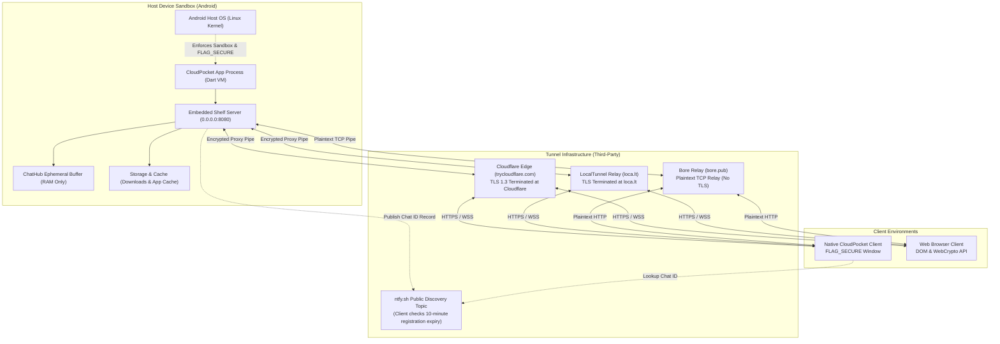

# CloudPocket — Security Architecture & Threat Model

This document outlines the security boundaries, cryptographic specifications, authentication flows, data storage mechanisms, and verified security properties of **CloudPocket** (v1.5.0+1).

---

## 1. Threat Model & Trust Boundaries

CloudPocket operates across multiple execution environments and network segments:



### 1.1 Trust Assumptions & Boundaries

1. **Host Device Authority**:
   - The host Android device runs the Shelf server and `ChatHub`. Therefore, the host device inherently possesses the room PIN, the invite token, and the derived encryption key.
   - The web client (`room.html` and `room.js`) is served directly by the host device. A compromised host device could theoretically modify `room.js` to exfiltrate keys or plaintext.
   - **Payload encryption limits**: AES-GCM encrypts message payloads, but admission credentials used to derive keys pass through the host and transport relay. The current protocol does not establish secrecy from relay operators. Local HTTP browsers without WebCrypto may send plaintext chat only with an explicit visible warning; HTTPS clients fail closed when encryption is unavailable.
2. **Third-Party Tunnel Relays**:
   - **Cloudflare & LocalTunnel**: Terminate TLS at their public relays. Traffic between client and relay is protected against passive observers on the public internet, but the relay operator terminates transport TLS. Room credentials and admission key material travel through that relay. AES-GCM encrypts chat payloads, but the current key exchange does not establish cryptographic secrecy from the relay operator.
   - **Bore**: Operates strictly over raw TCP without TLS. All traffic (including credentials and attachments) is plaintext HTTP on the wire and vulnerable to network inspection. Bore is explicitly marked in the UI and configuration as unencrypted transport.
3. **Discovery Service (`ntfy.sh`)**:
   - Maps dynamic `[A-Z]{2}-\d{4}` Chat IDs to tunnel URLs for PIN-protected rooms. Token-only rooms use full invite links.
   - New registrations contain the tunnel URL, optional room name, PIN-required flag, timestamp and expiry. Neither the PIN nor the invite token is published. The client rejects registrations after ten minutes; the active host renews them every five minutes.
   - Topics are public and unauthenticated. Expiry is enforced by CloudPocket, not a verified provider retention guarantee. Unregistering posts a tombstone; it does not delete earlier provider-held messages. Earlier versions may have published invite tokens. Public discovery does not authenticate ownership of a room URL.
   - After a successful PIN-protected join, the authenticated socket receives the room token needed to derive the shared chat key. That token is not included in public discovery.
4. **Clients**: Web browsers are treated as untrusted runtime environments where user scripts, extensions, or developer tools can inspect DOM and network traffic. Native CloudPocket clients enforce OS-level screenshot protections (`FLAG_SECURE`).

---

## 2. Cryptographic Architecture

CloudPocket employs a two-layer cryptographic model for Disposable Chat Rooms:

### 2.1 Transport Layer Security (Layer 1)
- **Cloudflare Quick (`trycloudflare.com`)**: Public traffic is encrypted using TLS 1.3 terminated at Cloudflare edge nodes.
- **LocalTunnel (`loca.lt`)**: Public traffic is encrypted using HTTPS/WSS terminated at `loca.lt`.
- **Bore (`bore.pub`)**: **No Transport Encryption**. Plaintext HTTP over raw TCP.

### 2.2 Authenticated payload encryption (Layer 2)
When WebCrypto is available, text messages exchanged in Disposable Chat Rooms are encrypted client-side using authenticated **AES-256-GCM** before transmission over WebSocket:

```
[Plaintext Message]
        │
        ▼
[Key Derivation] ───► SHA-256(secret) ──► 256-bit AES Key
        │
        ▼
[Cipher Initialization] ───► AES-256-GCM + 96-bit Random Nonce + 128-bit Auth Tag
        │
        ▼
[Ciphertext + Tag + IV] ───► Base64 JSON Frame { ciphertext, iv, alg: "AES-GCM" } ───► WebSocket Sink
```

#### Key Derivation & Credential Threat Model
- `E2eEncryptionService.computeSecret({String? token, String? pin})`:
  - Returns `$token:$pin`, `$token`, or `$pin` depending on configured credentials.
  - **Zero Fallback Secret**: If credentials are missing or empty, `computeSecret` returns `null`. The system **never** falls back to a predictable hardcoded key. If credentials are not set, E2E encryption is disabled.
- **Credential Entropy Properties**:
  - **Token-Only Mode (`$token`)**: A randomly generated 16-byte token supplies 128 bits of entropy before disclosure.
  - **Combined Mode (`$token:$pin`)**: SHA-256 derives the key from the token and PIN together. Protecting this key still depends on how those credentials are exchanged.
  - **PIN-Only Mode (`$pin`)**: A 4-digit PIN has only 10,000 combinations ($\approx 13.3$ bits of entropy). Even with key stretching, an offline attacker with captured ciphertext can exhaust all 10,000 keys in seconds. Therefore, the room PIN serves primarily as an **online access-control gate** on the server (enforcing connection rate limits and rejecting unauthorized join requests), NOT as high-entropy cryptographic key material. Users requiring cryptographic secrecy must use invite tokens or combined mode.

#### Implementation & Authenticated Decryption
- **Flutter Client**: Uses `pointycastle` (`GCMBlockCipher(AESEngine())`, `AEADParameters`, `Random.secure()`).
- **Web Browser Client**: Uses the standard Web Crypto API (`window.crypto.subtle.encrypt({ name: 'AES-GCM', iv, tagLength: 128 }, key, data)`).
- **Authentication & Integrity**: Every ciphertext includes a 128-bit authentication tag. If an attacker modifies even a single bit of ciphertext or IV, decryption fails immediately and returns `null`.
- **Backward-Compatible Migration**: `E2eEncryptionService.decrypt` inspects the IV length. If a 12-byte (96-bit) IV is present, it executes authenticated AES-256-GCM. If a legacy 16-byte (128-bit) IV is present, it falls back to legacy AES-256-CBC with PKCS7 padding.

---

## 3. Authentication & Authorization Pipeline

### 3.1 Strict PIN Enforcement (No Token Bypass)
In `ChatHub._handleJoin` (`lib/server/chat_hub.dart`) and `POST /api/room/auth` (`lib/server/server_engine.dart`):

1. **PIN-Protected Rooms (`requirePin == true`)**:
   - A valid PIN is strictly mandatory and **cannot be bypassed by possessing an invite token**.
   - If the client supplies an invite token but omits or provides an invalid PIN, entry is rejected with `PIN_REQUIRED` or `INVALID_PIN`.
   - If an invite token is also configured and supplied, it must match (`INVALID_TOKEN` if mismatch).
2. **Token-Only Rooms (`requirePin == false`, `inviteToken.isNotEmpty`)**:
   - Valid invite token is required to enter. Rejection with `TOKEN_REQUIRED` or `INVALID_TOKEN` if missing or mismatched.
3. **Open Rooms**:
   - Accessible without credentials.

### 3.2 Room Attachment Authorization
- Requests to `POST /api/room/upload` and `GET /api/room/files/<filename>` are strictly authorized by `AuthManager`:
  - When `requirePin == true`, clients must hold an authenticated session cookie (`cp_session`) verified via `/api/room/auth`. Unauthenticated requests receive `HTTP 401 Unauthorized`.
  - Upload file size limits (`session.roomConfig.maxFileSizeMb`) are enforced on the incoming stream. Transfers exceeding the limit are terminated, partial files are purged, and `HTTP 413 Payload Too Large` is returned.

---

## 4. Storage Security & File Deletion Reality

### 4.1 Storage Separation
- **File Sharing Uploads**: Saved to `/storage/emulated/0/Download/CloudPocket` (shared external storage, accessible to apps holding storage permissions).
- **Disposable Room Attachments**: Saved to sandboxed application cache: `<cacheDir>/disposable_room_<roomId>/` (private on non-rooted Android).

### 4.2 Path Traversal Sanitization
Both `UploadHandler` and `ServerEngine` sanitize all incoming filenames:
```dart
final sanitized = p.basename(Uri.decodeComponent(rawFilename));
```
Directory separators (`/`, `\`) and traversal tokens (`../`, `..\`) are stripped.

### 4.3 Data Deletion Reality
- **Implementation**: `DisposableRoom._safelyDeleteDirectory` executes standard Dart `File.deleteSync()` and `Directory.delete(recursive: true)`.
- **Flash Memory Reality**: Modern mobile flash storage (eMMC / UFS) utilizes wear-leveling and Flash Translation Layers (FTL). Software-level zero-byte overwrites do not guarantee physical erasure of underlying NAND flash blocks. Standard OS deletion unlinks file pointers and reclaims blocks, which is the correct mobile pattern. The application does not claim military-grade physical data shredding.

---

## 5. Two-Tier Screenshot Protection: Guarantees & Limitations

### 5.1 Native Tier (`FLAG_SECURE`)
- **Mechanism**: Calls `window.addFlags(WindowManager.LayoutParams.FLAG_SECURE)` in `MainActivity.kt`.
- **Enforcement**: Handled by Android SurfaceFlinger compositor.
- **Guarantees**:
  - Physically blocks hardware screenshot key combinations (Power + Vol Down).
  - Blocks Android OS screen recording tools (records black frames).
  - Replaces the app thumbnail in the system Recent Apps / Task Switcher with a blank screen.
- **Limitations**:
  - Does not protect against external physical camera lenses photographing the phone screen.
  - Does not protect against compromised Android devices running root-level frame buffer capture tools.

### 5.2 Browser Tier (Web Deterrents)
- **Mechanism**: CSS `user-select: none`, context menu suppression, `@media print { display: none !important; }`, dynamic diagonal watermark overlays displaying participant nickname and IP.
- **Guarantees**: Deterrent against accidental copying or printing.
- **Limitations**: **Cannot prevent OS-level screenshots or screen recordings.** Any browser user can capture screenshots using OS tools. The web interface explicitly discloses this limitation.

---

## 6. Security Best Practices for Maintainers

1. **Never Log Sensitive Content**: Never log decrypted chat text, room PINs, invite tokens, or auth cookies in `AppLogger`.
2. **Streaming Without Whole-File Buffering**: Always pipe streams directly into `IOSink` to prevent memory exhaustion attacks.
3. **Always Validate Input Sizes**: Enforce upload file size caps and nickname length limits.
4. **Preserve Path Sanitization**: Always use `p.basename(Uri.decodeComponent(name))` on user-supplied filenames.
5. **Enforce Strict Credential Policy**: Never allow invite tokens to bypass required room PINs.
