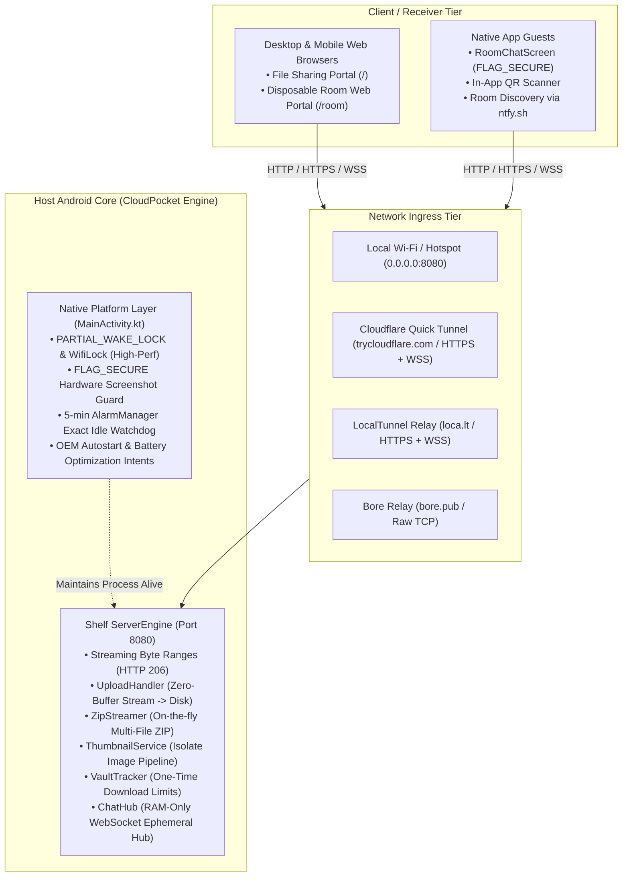
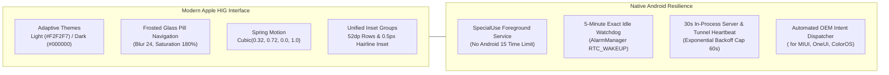
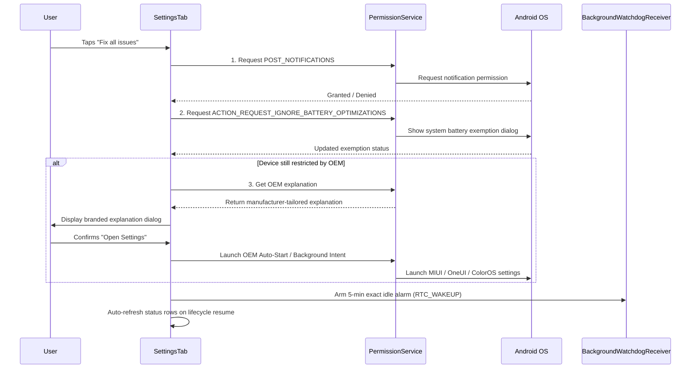
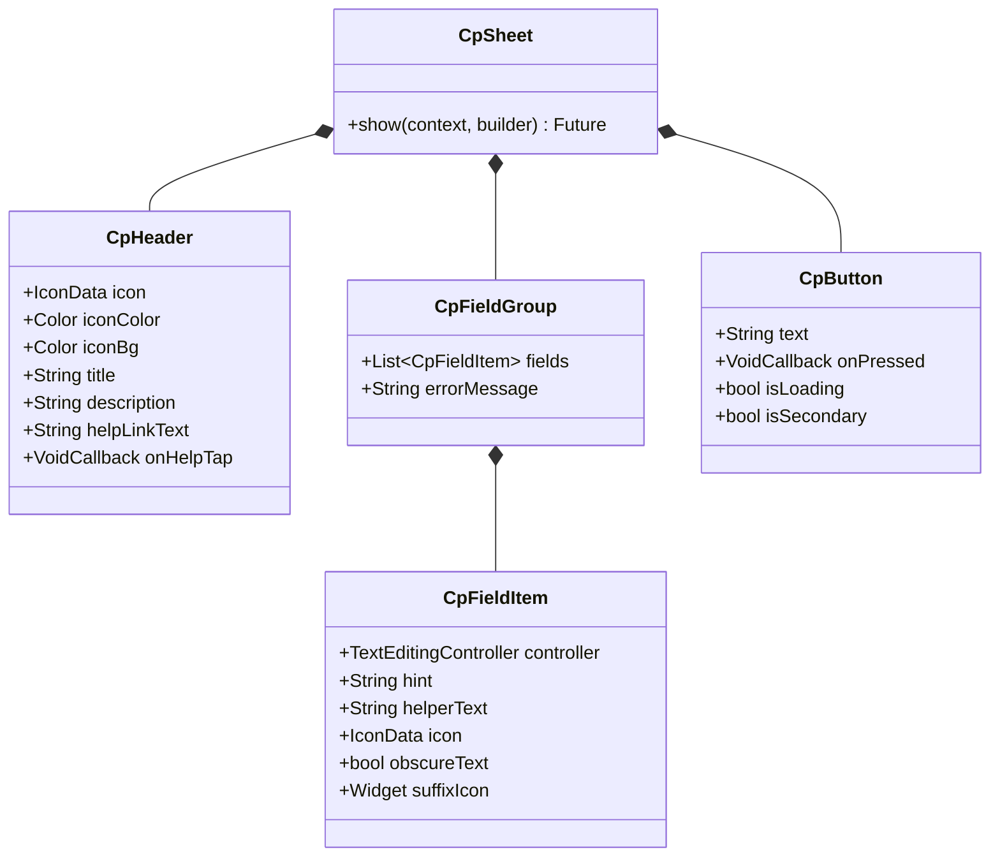

# CloudPocket: Comprehensive UI/UX & Functional Evolution Guide (Old App vs. New App)

This document provides the authoritative, technical, and architectural reference detailing the comprehensive functional and design transformation of **CloudPocket** (v1.5.0+1). It contrasts the legacy **Material 3 / Android Holo** developer implementation with the modern **Apple Human Interface Guidelines (HIG)** consumer design system.

---

## 1. System Topology & Architectural Overview

---

## 2. In-Depth Breakdown of the Old App

### 2.1 Design Philosophy & Visual Interface
The legacy CloudPocket interface was conceived as a technical Android utility:
- **Color Palette**: A static dark slate theme (`#0F172A` canvas, `#1E293B` cards, `#334155` borders) with green and indigo accents. There was no light mode support.
- **Card Styling & Radii**: Boxy, uniform 12dp to 16dp corner radii across all surfaces, dialogs, and cards.
- **Navigation**: Utilized a third-party curved bottom navigation bar (`SmoothCurvedNavBar`) with cutout wells and standard Material AppBars.
- **Micro-Interactions**: Default linear or ease-in transitions; buttons used standard Android Material ink ripple splashes on touch.

### 2.2 Functional Architecture & Workflows
1. **File Selection**:
   - Tapping "Select Files / Folder" opened `FileSelectorScreen`. Files were categorized into Images, Video, Audio, Docs, and Archives.
2. **Mode Switching**:
   - Send Mode and Receive Mode competed on the same screen via standard checkboxes or radio buttons, leading to state ambiguity.
3. **Starting the Server**:
   - Tapping "Start Sharing" bound the local Shelf server to port `8080` and started an Android foreground service with type `dataSync`.
4. **QR Code Sharing & Link Distribution**:
   - The old app rendered a basic modal dialog with a square black-and-white QR code.
   - The local IP address was displayed as raw text (e.g. `http://192.168.1.104:8080`).
   - Tapping "Copy" displayed a transient `SnackBar` at the bottom of the screen.
   - Tapping "Share" invoked Android's system share sheet with plain URL text.
5. **Disposable Chat Rooms**:
   - The room generated a 6-character code (e.g. `NX-7204`) and invite token.
   - Participants had to manually transcribe or copy-paste room URLs and PINs. There was no integrated, in-app QR code sheet on the host live screen to quickly invite guests.
6. **Background Execution & OEM Kill Prevention**:
   - The Settings screen had three separate, hardcoded rows: "Xiaomi autostart", "Samsung battery", and "Oppo and Vivo".
   - The "Keep running" toggle was not persisted to disk.
   - On Android 11+ (API 30+), these OEM deep links failed or crashed silently because `<queries>` declarations were missing from `AndroidManifest.xml`.
   - On Android 15, the `dataSync` foreground service type was subject to a 6-hour system execution timeout.

---

## 3. In-Depth Breakdown of the New App

### 3.1 Design Tokens & Visual Hierarchy
The redesigned CloudPocket strictly complies with the **Apple Human Interface Guidelines (HIG)**:
- **Dual Adaptive Themes** ([`theme.dart`](file:///f:/Project/CloudPocket/lib/ui/theme.dart)):
  - **Light Mode**: Canvas `#F2F2F7`, Card `#FFFFFF`, Label `#000000`, Label2 `#6C6C70`, Hairline Sep `rgba(60,60,67,0.18)`, Fill `rgba(120,120,128,0.12)`.
  - **Dark Mode**: Canvas `#000000`, Elevated Cards `#1C1C1E`, Label `#FFFFFF`, Label2 `#9A9AA1`, Hairline Sep `rgba(84,84,88,0.55)`, Fill `rgba(120,120,128,0.24)`.
  - **Semantic Accents**: Blue (`#007AFF` / `#0A84FF`), Green (`#34C759` / `#30D158`), Red (`#FF3B30` / `#FF453A`), Orange (`#FF9500` / `#FF9F0A`).
- **Continuous Radii Hierarchy**:
  - Cards: `26dp` | Inset Groups: `18dp` | Buttons: `17dp` | Segment Controls: `12dp` | Action Pills: `20dp` | Icon Tiles: `8dp` to `11dp`.
- **Apple Grouped Inset Lists**: Minimum row height `52dp`, `0.5px` hairline separator inset by `58px` (clearing squircle icon tiles).
- **iOS Switches**: `51dp × 31dp` container with `27dp` circular knob and spring glide animation.
- **Universal Motion Physics**: Systematic application of `Cubic(0.32, 0.72, 0.0, 1.0)` with `0.97` tactile compression scaling on press.

---

## 4. QR Code & Link Sharing in the New App

> [!IMPORTANT]
> **Ephemeral Web Server Mechanics**: CloudPocket does not generate arbitrary links before the server binds to a live socket. Dynamic QR codes and authenticated links are generated instantly upon session startup.

### 4.1 File Sharing & Receive Mode (`SharingLiveView`)
When the user taps **"Start Sharing"** (Send Mode) or **"Start Receiving"** (Receive Mode):

1. **Slide-Up Bottom Sheet**: A `30dp` top-radius sheet with a `38×5` pill grabber and dim backdrop slides up smoothly from the bottom.
2. **Encapsulated White QR Card**:
   - A dedicated `236dp` high-contrast white card containing the live [`PrettyQrView`](https://pub.dev/packages/pretty_qr_code) with smooth rounded modules and finders.
   - Any camera or QR scanner scanning this card connects directly to the phone's web portal.
3. **Selectable URL Bar**:
   - Displays the active HTTP/HTTPS address in tabular figures font for easy reading.
4. **Interactive Multi-Interface Network Chips**:
   - Chips for **Wi-Fi**, **Hotspot**, and **Tunnel** allow immediate toggling of the active interface. The QR code and URL dynamically update in real time without restarting the server.
   - If multiple IP interfaces exist (e.g. Wi-Fi + USB tethering), an "Alternative IPs" wrap allows one-tap switching.
5. **Quick-Action Buttons Trio**:
   - **`Copy`**: Copies the active URL to the clipboard with haptic feedback and displays a `"Link copied"` glass pill.
   - **`Share`**: Captures the QR code widget into a clean PNG image and opens the native Android Share Sheet with both the QR image file and the URL text: `"Connect to CloudPocket: http://..."`.
   - **`Open`**: Instantly launches the web portal on the host device's default browser via [`OpenFilex`](https://pub.dev/packages/open_filex).
6. **Home Screen Indicator**: A persistent helper badge (`Icons.qr_code_2_rounded`) on the Home screen explicitly informs users: *"Generates instant QR code & link sharing"*.

### 4.2 Disposable Ephemeral Chat Rooms (`DisposableRoomLiveView`)
The active disposable room dashboard provides a dedicated QR code and invite link sharing suite:

1. **"Invite link & QR" Interactive Inset Row**:
   - Inside the Room code and PIN group, a dedicated row with QR code and share icons gives immediate visual affordance.
   - Tapping this row opens the **Room Invite Sheet**.
2. **Dedicated "Share Invite & QR Code" Action Button**:
   - Positioned directly above "Open Chat" for prominent discovery.
3. **Room Invite Sheet ([`CpSheet`](file:///f:/Project/CloudPocket/lib/ui/widgets/cp_sheet.dart))**:
   - Displays a `220dp` white rounded card encoding the full authenticated room link: `http://<address>/room?token=<inviteToken>&pin=<pin>`.
   - **"Share invite link"**: Opens the native share sheet with complete room credentials and deep link for messaging apps (WhatsApp, Telegram, Slack).
   - **"Copy link"**: Places the full room URL onto the clipboard.

---

## 5. Background Protection Suite (Task A Architecture)

### 5.1 Native Keep-Alive Enhancements
- **Foreground Service Type**: Migrated from `dataSync` to `specialUse` with `android.app.PROPERTY_SPECIAL_USE_FGS_SUBTYPE` declared as `"Local file transfer server and public tunnel daemon"`. This completely eliminates the Android 15 six-hour time limit.
- **Hardware Locks**: Holds `PARTIAL_WAKE_LOCK` + `WifiLock` (`WIFI_MODE_FULL_HIGH_PERF`) + `MulticastLock` while the server runs, releasing them cleanly on stop.
- **Native Watchdog**: Uses `AlarmManager.setExactAndAllowWhileIdle` every 5 minutes (with graceful fallback to `setAndAllowWhileIdle` if exact alarms are denied) to resurrect the service if terminated by aggressive OEM memory cleaners.
- **Broadcast Receivers**: Registered `BackgroundWatchdogReceiver` for `BOOT_COMPLETED`, `MY_PACKAGE_REPLACED`, and `ACTION_WATCHDOG_PING`. It verifies the persisted `keepRunning` preference before re-arming.
- **In-Process 30s Heartbeat**: Probes local HTTP port reachability every 30 seconds. If unreachable, attempts automatic restart with exponential backoff (capped at 60s). Automatically reconnects tunnels on network interface change.
- **OEM Package Visibility**: Declared `<queries>` in [`AndroidManifest.xml`](file:///f:/Project/CloudPocket/android/app/src/main/AndroidManifest.xml) for Xiaomi MIUI/HyperOS, Oppo/Realme ColorOS, Vivo/iQOO, Huawei/Honor EMUI, and Samsung OneUI.

---

## 6. Reusable Sheet Architecture (Task B Architecture)

Both **Custom Bore VPS Relay** and **Cloudflare Custom Domain** dialogs were completely rebuilt on a unified component base ([`cp_sheet.dart`](file:///f:/Project/CloudPocket/lib/ui/widgets/cp_sheet.dart)):
1. **Zero Keyboard Overflow**: Wrapped in `SingleChildScrollView` with `bottom: viewInsets.bottom`, `isScrollControlled: true`, and `useSafeArea: true`. Tested cleanly at 360dp width and 1.3 font scale with virtual keyboard open.
2. **Standardized Header**: 30dp squircle colored icon tile + 22sp bold title + 30dp circular fill close button.
3. **No Floating Labels**: Replaced floating label text with clean, persistent hint text inside 52dp inset rows.
4. **44dp Touch Targets**: Suffix icons (eye toggle, clipboard paste) use minimum 44dp touch targets.
5. **Inline Error Typography**: Replaced transient snackbars with inline red error text directly below fields.
6. **Animated Domain Discovery**: Cloudflare domain discovery smoothly expands (`AnimatedSize` with cubic-bezier) a list of discovered zones with checkmark selection and subdomain prefix configuration.

---

## 7. Comparative Audit Matrix

| Feature / Domain | Legacy Material 3 Design | Modern Apple HIG Design System |
| :--- | :--- | :--- |
| **Theme Support** | Static dark slate only | Dual system-adaptive (Light `#F2F2F7` / OLED Dark `#000000`) |
| **Motion Physics** | Android default ease/linear | Universal `Cubic(0.32, 0.72, 0.0, 1.0)` + 0.97 press compression |
| **Home Mode Switcher** | Radio buttons / checkboxes | 3-way spring segmented control (`Send \| Receive \| Room`) |
| **Sharing Sheet** | Modal popup with square QR | Slide-up `CpSheet` with rounded-module QR card (`PrettyQrView`) |
| **Live Network Switching**| Re-launch required | Live chips (Wi-Fi, Hotspot, Tunnel, Alternative IPs) |
| **QR Code Export** | Plain text URL sharing only | High-resolution PNG image export + URL via system share sheet |
| **Room Invite QR & Link** | Manual code sharing only | Dedicated `Invite link & QR` row + `Share Invite & QR Code` sheet |
| **Custom Domain Forms** | Material dialog with overflow bugs | Unified `CpSheet` + `CpFieldGroup` with zero overflow guarantee |
| **Background Keep-Alive** | Unpersisted toggle, 3 OEM rows | Persisted state, 4 live status diagnostics, sequential "Fix all issues" CTA |
| **Android 15 Foreground** | `dataSync` (6-hour timeout) | `specialUse` with native subtype + 5-minute exact idle watchdog |
| **Web Client Portals** | Static dark theme | Synchronized CSS tokens with automatic Light/Dark mode |

---

## 8. Verification & Engineering Compliance

- **Rule 1 (APK Authorization)**: `flutter build apk --release` is strictly executed only upon explicit user command.
- **Rule 2 (Zero Unsolicited Touch)**: Core Shelf server engine, file streaming, range requests, PointyCastle AES-256-GCM cryptography, and tunnel protocols were preserved without regression.
- **Rule 3 (Zero Memory Buffering)**: File transfers stream directly via `request.read() -> IOSink`.
- **Static Analysis**: `flutter analyze` reports **0 issues**.
- **Automated Test Suite**: **160 tests pass** across 33 test files (`flutter test`).
- **Production Build Artifact**: Assembled release APK at [`build/app/outputs/flutter-apk/app-release.apk`](file:///f:/Project/CloudPocket/build/app/outputs/flutter-apk/app-release.apk) (31.7 MB).
