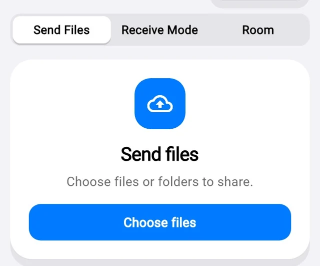
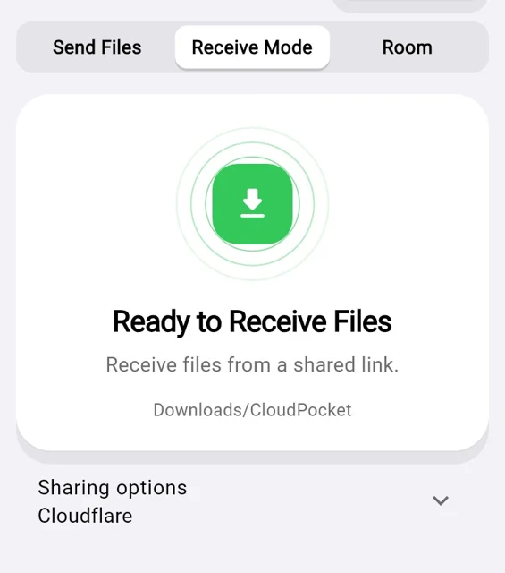
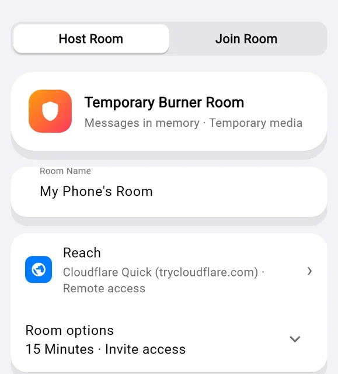
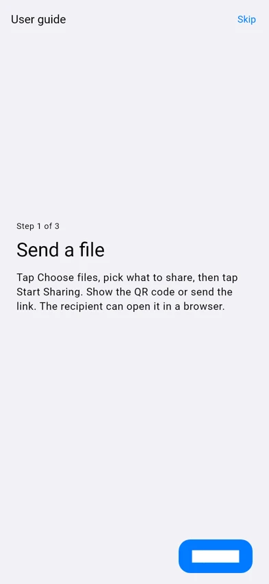

# User guide and Home tour

Settings → User guide opens three illustrated pages. Each page teaches one task with a crop of the actual Android screen.

| Send a file | Receive files | Start a room |
| --- | --- | --- |
|  |  |  |
| Choose a file, start sharing, then share the link or QR code. | Start receiving and let the sender upload through their browser. | Choose a timer and invite someone into a temporary conversation. |

## Navigation

On first launch, Home waits for the initial permission requests to finish. A six-step tour highlights Choose files, Sharing options, Receive Mode, Room, History and Settings. Each step has Skip, a counter and Next or Done. Settings → Replay tour opens it again. The separate illustrated guide remains available in Settings.

## Layout and verification

Keep one illustration, one heading and short instructions per page. Keep navigation reachable on small screens and allow the body to scroll with large text. Use accessible control labels and a readable page counter. Verify first-launch completion, skip, and Settings replay with widget tests.

## Illustrated guide in Settings

